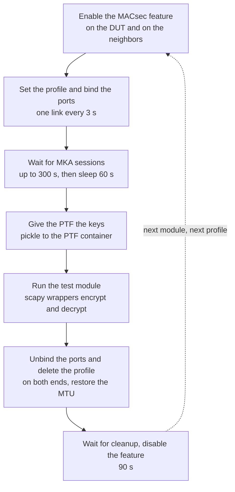
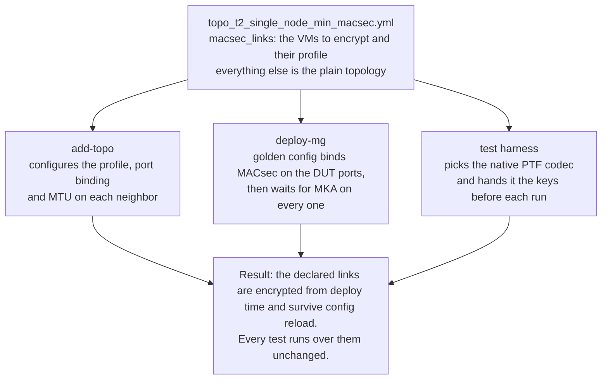
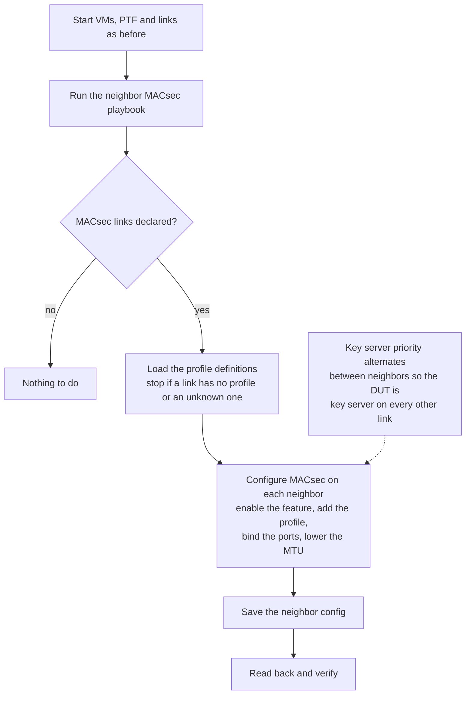
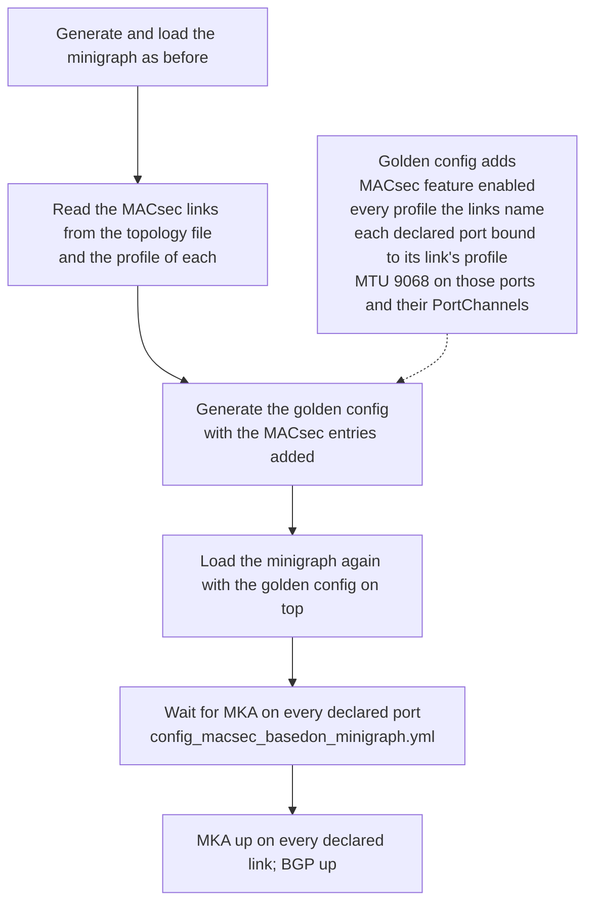
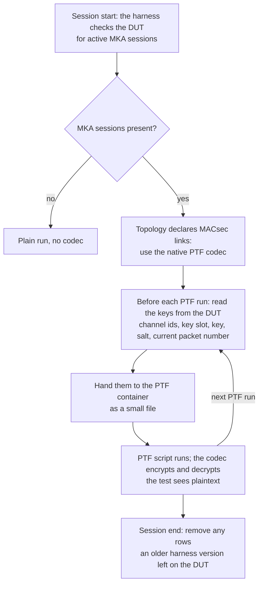
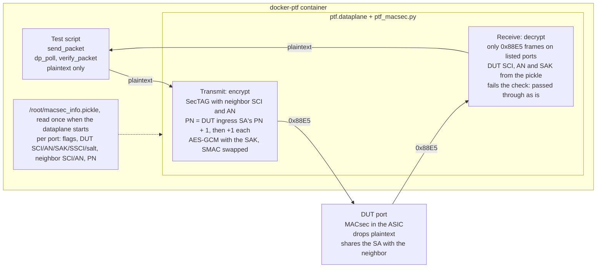

# Always-On MACsec Testbed #

## Table of Content

- [1. Revision](#1-revision)
- [2. Scope](#2-scope)
- [3. Definitions/Abbreviations](#3-definitionsabbreviations)
- [4. Overview](#4-overview)
- [5. Requirements](#5-requirements)
- [6. Architecture Design](#6-architecture-design)
  - [6.1 How MACsec testing works today](#61-how-macsec-testing-works-today)
  - [6.2 What is new](#62-what-is-new)
- [7. High-Level Design](#7-high-level-design)
  - [7.1 Topology declaration](#71-topology-declaration)
  - [7.2 add-topo: the neighbors get MACsec](#72-add-topo-the-neighbors-get-macsec)
  - [7.3 deploy-mg: the DUT gets MACsec](#73-deploy-mg-the-dut-gets-macsec)
  - [7.4 Test run flow](#74-test-run-flow)
  - [7.5 PTF native codec](#75-ptf-native-codec)
  - [7.6 Keys, slots and packet numbers](#76-keys-slots-and-packet-numbers)
- [8. Configuration and management](#8-configuration-and-management)
  - [8.1 Manifest](#81-manifest)
  - [8.2 CLI/YANG model Enhancements](#82-cliyang-model-enhancements)
  - [8.3 Config DB Enhancements](#83-config-db-enhancements)
  - [8.4 MACsec profile](#84-macsec-profile)
  - [8.5 Setup steps](#85-setup-steps)
- [9. Memory Consumption](#9-memory-consumption)
- [10. Restrictions/Limitations](#10-restrictionslimitations)
- [11. Testing Requirements/Design](#11-testing-requirementsdesign)
  - [11.1 Unit Test cases](#111-unit-test-cases)
  - [11.2 System Test cases](#112-system-test-cases)

### 1. Revision

| Rev | Date | Author | Change |
|-----|------|--------|--------|
| 0.1 | 2026-10-22 | Devesh Pathak (Nexthop) | First draft. Topology-declared MACsec, PTF native codec, replay protection off. |

### 2. Scope

This document describes a testbed where MACsec is on from deploy time on selected neighbor links, so that any sonic-mgmt test runs over encrypted links without change.

In scope:

- The topology declaration (`macsec_links`) and the three stages that read it: `add-topo`, `deploy-mg` and the test harness.
- The PTF native MACsec codec in docker-ptf.
- The profile settings the testbed needs, and why.

Out of scope:

| Item | Reason |
|------|--------|
| `tests/macsec` | Those tests enable MACsec themselves and still run on plain testbeds. They are skipped on this topology |
| Multi-ASIC DUTs | Only single-ASIC is tested |
| Rekey during a test run | The PTF holds a key snapshot. See [7.6](#76-keys-slots-and-packet-numbers) |
| cEOS neighbors | `config_macsec_neighbors.yml` has a cEOS branch, but it has not been tested. The testbed uses vSONiC |

Tests that need some rework to run on this testbed:

| Item | Reason |
|------|--------|
| ipfwd `test_mtu` | Sends a fixed 9114 B frame; on a MACsec link the 32 B overhead pushes it past the L3 MTU, so the frame must stay within min(src, dst) L3 MTU + 14 (9068 → 9082 B) |
| bfd `test_bfd`, `test_micro_bfd` | PTF kernel BFD peer sends cleartext, which the DUT drops on a MACsec port; a MACsec-aware peer or non-MACsec ports are needed |
| bgp exaBGP PTF tests (`test_bgp_update_timer`, `test_bgp_peer_shutdown`) | PTF exaBGP speaks cleartext BGP to the DUT over a MACsec T3 link, so the session never comes up |
| copp | CoPP flood starves MKA in the shared `queue4_group1`, the link re-keys mid-test and the PTF keeps the old SA |
| drop_packets `test_drop_counters` exceeded_mtu | 9100 B probe + 32 B MACsec overhead exceeds the fanout MTU, so the frame never reaches the DUT |
| pfcwd `test_pfcwd_cli` | PTF ingress SA programming per `ptf_runner` eats most of the 60 s fanout storm, so traffic is sent after the storm has ended |
| pfcwd `test_pfcwd_all_port_storm`, `test_pfcwd_timer_accuracy` | PFC watchdog never detects a storm on a MACsec port although Rx PFC counters climb (product bug); `timer_accuracy` also picks `test_ports[0]`, which is a MACsec port |
| pfcwd / fdb port selection | `select_test_ports` assumes bare L3 links and raises IndexError on all-LAG T2 min topologies |
| fdb `test_fdb_mac_move` | PTF storm script sends raw cleartext frames on the MACsec ports, so no MAC move is observed |
| everflow | Egress-ACL everflow is not supported on broadcom-dnx MACsec ports; the ingress ERSPAN copy of a decrypted frame carries the 4 B SVTAG, so the PTF never matches it (product bug) |
| fib / vxlan hash | T2 outer-IP ranges fall outside the routed space on this topology, and voq hashing on the ingress port does not apply to T2 routing |
| ztp | ZTP cannot run on a MACsec-provisioned DUT: links cannot come up before MACsec is configured |

### 3. Definitions/Abbreviations

| Term | Meaning |
|------|---------|
| MACsec | IEEE 802.1AE link-layer encryption |
| MKA | MACsec Key Agreement, the protocol (802.1X) that negotiates keys between the two ends of a link |
| CAK / CKN | The pre-shared key and its name, from which MKA derives the data key |
| SAK | Secure Association Key, the data key MKA distributes |
| SC / SCI | Secure Channel, one direction of a link, and its identifier |
| SA / AN | Secure Association, one of four key slots in a channel, picked by the 2-bit Association Number |
| PN / XPN | Packet Number carried in every frame, 32-bit; XPN extends it to 64-bit |
| SecTAG / ICV | The MACsec header and the integrity check value at the end of the frame |
| Replay protection | The receiver drops frames whose PN falls behind an accepted window |
| Golden config | `/etc/sonic/golden_config_db.json`, applied on top of the minigraph at deploy time and on every config reload |
| PTF | Packet Test Framework, the container that injects and captures test traffic |
| Native codec | `ptf_macsec.py` inside docker-ptf, which encrypts and decrypts in `ptf.dataplane` |
| Monkeypatch | The older scapy wrappers in `ptftests/macsec.py` that only encrypt for scripts that `import macsec` |
| DUT | Device under test |

### 4. Overview

We want every ordinary test (fib, acl, bgp, copp, everflow and so on) to run over MACsec links without changing the tests. Today only `tests/macsec` ever sees MACsec, and it turns MACsec on and off itself. Problems that only appear when ordinary traffic crosses an encrypted link are not covered.

MACsec is declared once, in the topology file, and three existing stages read that declaration:

| Stage | What it does with `macsec_links` |
|-------|----------------------------------|
| `add-topo` | Configures the neighbor VMs: feature, profile, port binding, MTU |
| `deploy-mg` | Binds the DUT ports through the golden config, then waits for MKA |
| Test harness | Picks the PTF native codec and hands it the keys before each PTF run |

After deploy-mg, the declared links are encrypted, `config reload` restores them, and every test runs over them unchanged.

### 5. Requirements

| # | Requirement |
|---|-------------|
| R1 | MACsec is a property of the topology, not of a test. The topology file names the encrypted links and the profile of each one; nothing else has to be told |
| R2 | MACsec is up after `deploy-mg`, and a `config reload` on the DUT restores it without re-running ansible |
| R3 | PTF traffic works on every test. The PTF encrypts what it sends and decrypts what it receives with no change to test code |
| R4 | No Python work per packet on the PTF side. Timing sensitive suites (fib, hash, pfcwd, copp) keep their numbers |
| R5 | Plain testbeds and the per-test flow in `tests/macsec` keep working exactly as before |
| R6 | The topology file names the profile for each link, and `profile.json` holds the settings of each profile, unchanged from upstream. Replay protection is off unless a profile turns it on |

### 6. Architecture Design

#### 6.1 How MACsec testing works today

Today MACsec is something a test does, not something the testbed has. The plugin in `tests/common/macsec/__init__.py` only loads with `--enable_macsec` and wraps every module in the macsec folder with a setup and a teardown.



The loop runs once per profile in `profile.json`, for every module. Setup takes several minutes and teardown waits 90 s for the DUT to clean up.

- **Neighbors are configured by the test.** vSONiC neighbors get the same CLI as the DUT plus `config save -y`. EOS neighbors get `mac security` CLI.
- **PTF encryption is a monkeypatch.** The test process wraps scapy's `send_packet` and `dp_poll`. Scripts run by `ptf_runner` get the same wrappers from `ptftests/macsec.py`, fed by `/root/macsec_info.pickle`. Only scripts that `import macsec` encrypt. Anything else sends plaintext and the DUT drops it.
- **Only the macsec folder benefits.** fib, acl, bgp, everflow and the rest never go through this flow.

This flow stays as it is for plain testbeds. The always-on topology is added next to it, not instead of it.

#### 6.2 What is new



Compared with 6.1, three things change:

| | Today (per test) | New (always-on) |
|---|---|---|
| Who turns MACsec on | The macsec test plugin, per module | `deploy-mg` on the DUT, `add-topo` on the neighbors |
| Where the DUT config lives | Runtime CONFIG_DB writes, lost on reload | Golden config, restored by `config reload` |
| How the PTF encrypts | scapy wrappers, per script that imports `macsec` | A codec inside the PTF dataplane, for every script |

The pieces, by repository:

| Repository | Files |
|---|---|
| sonic-mgmt | topology file, `config_macsec_neighbors.yml`, `config_macsec_basedon_minigraph.yml`, `generate_golden_config_db.py`, `macsec_helper.py`, `conftest.py` |
| sonic-buildimage | `dockers/docker-ptf/ptf_macsec/ptf_macsec.py` |

### 7. High-Level Design

#### 7.1 Topology declaration

The topology file is the plain `t2-single-node-min` topology plus one block. Nothing keys off the topology name.

```yaml
macsec_links:
  - vm: VM01T3
    profile: 256_XPN
  - vm: VM02T3
    profile: 256_XPN
  - vm: VM03T3
    profile: 128_XPN
```

Profile names refer to `tests/common/macsec/profile.json`. Each link carries its own profile, so different links can run different ciphers and key sizes when needed; the testbed uses `256_XPN` on two links and `128_XPN` on the third, so every run covers per-link profiles. Links behind a PortChannel and bare-port links are both supported.

#### 7.2 add-topo: the neighbors get MACsec

`add-topo` already starts the neighbor VMs and the PTF. One playbook is added at the end, `config_macsec_neighbors.yml`. It runs for every topology and ends at once when the topology declares no MACsec links.



Everything the playbook needs is on the test server: the topology file, the VM addresses, and the profile definitions. It never talks to the DUT, so add-topo can run before the DUT image is installed.

For each neighbor in the declaration, the playbook finds the ports that face the DUT and configures them:

1. Enable the MACsec feature on the neighbor.
2. Add the profile, copied from the profile definitions. The replay window is only written when replay protection is on, because the YANG model rejects it otherwise.
3. Bind the profile to every DUT-facing port. PortChannel members stay in the LAG; MKA runs on the member port directly.
4. Lower the MTU to 9068, because MACsec adds 32 bytes to every frame and the ASIC frame limit is 9100.

The config is then saved, so a later config reload on the neighbor (the bgp tests do this) keeps MACsec.

The key server priority alternates between neighbors so that both key server roles are covered on one testbed. MKA makes the end with the lowest number the key server. Neighbors at even positions in the declaration get a lower number than the DUT and become key server; neighbors at odd positions get a higher number, so the DUT is key server on those links.

The playbook supports vSONiC and cSONiC neighbors. It also has a cEOS branch, which is out of scope and untested.

#### 7.3 deploy-mg: the DUT gets MACsec

The DUT side is bound through the golden config, not through runtime writes. A minigraph cannot carry a MACsec profile, but the golden config is applied on top of the minigraph both at deploy time and on every config reload, so whatever it says comes back after a reload.



1. The minigraph is generated and loaded as on any topology, so the port tables exist.
2. The play reads the MACsec links from the topology file. Every link must name a profile, or the play stops with an error.
3. The golden config generator adds the MACsec entries: the feature, every profile the links name, each DUT port that faces a declared neighbor bound to that link's profile, and the lower MTU on those ports and their PortChannels. A profile missing from the profile definitions stops the play rather than falling back to another.
4. The minigraph is loaded again with the golden config on top.
5. A final playbook, `config_macsec_basedon_minigraph.yml`, finds the ports that carry a MACsec binding and waits until the DUT reports the MKA session as up on each one. It allows up to ten minutes per port, because MKA on Broadcom DNX can take a while after SDK init. It does not wait for BGP; BGP comes up by itself once the links are encrypted.

The harness's own config reload helper keeps the golden config in play whenever the DUT has MACsec tables, so tests that reload the DUT do not strip MACsec.

#### 7.4 Test run flow

No test is told about MACsec. The harness detects it from the DUT state.



1. **Detection.** At session start the harness asks the DUT whether any MKA sessions are up. If so, MACsec is on for this run. If the topology also declares MACsec links, the PTF is put in native codec mode. Otherwise the old monkeypatch is used, which is what `tests/macsec` on a plain testbed needs.
2. **Reading the keys.** Before every PTF run the harness reads, for each MACsec port, the DUT's transmit channel and key slot with the key, salt and short channel id, the neighbor's receive channel and key slot, and the current packet number. Nothing is written to the DUT.
3. **Handoff.** The values are written to a small file inside the PTF container. A second marker file says the native codec is present. Those two files are the whole interface between harness and PTF.
4. **Run.** The PTF dataplane reads the file once at start and encrypts every frame it sends on a listed port and decrypts every frame it receives. The script, its masks and its packet polling see plaintext.
5. **Session end.** The harness removes any PTF-specific rows that an older harness version may have left on the DUT. The current harness creates none.

`tests/macsec` is skipped on this testbed, since those tests expect to enable MACsec themselves.

#### 7.5 PTF native codec

The encryption lives in the PTF's dataplane, below the scripts. The code is `dockers/docker-ptf/ptf_macsec/ptf_macsec.py` in sonic-buildimage, shipped inside the docker-ptf image.



**Activation.** When `ptf.dataplane` starts it tries to import `ptf_macsec`. If the module is present and `/root/macsec_info.pickle` exists, it installs a transmit hook and a receive hook on every port listed in the pickle and sets `ptf.dataplane.NATIVE_MACSEC_CAPABLE`. The monkeypatch in `ptftests/macsec.py` checks that flag and does nothing, so no frame is encrypted twice. If the image has no codec, the marker file is never written and the monkeypatch works as before.

**Transmit.** For a frame leaving on a MACsec port the hook builds a SecTAG with the neighbor's SCI and AN, assigns the next packet number, encrypts the payload with AES-GCM using the SAK, and appends the ICV. Key size and the XPN flag come from the SAK length and the pickle, so 128, 256, XPN-128 and XPN-256 all work. On a Broadcom DUT the outer source MAC is rewritten to the neighbor's MAC, because the ASIC finds the secure channel by that address. The packet number starts at the DUT ingress SA's current PN plus one, as the harness hands it over, and steps by one per frame. No offset is added: with replay protection off the DUT accepts a PN below its highest-seen one, so the PTF only has to avoid PN 0, which the standard reserves, and on XPN stay within 2^31 of the SA's counter, from which the receiver recovers the upper 32 bits.

**Receive.** The hook only touches frames with EtherType 0x88E5 on listed ports. It decrypts with the DUT's SCI, AN and SAK and hands the plaintext up. A frame that fails the integrity check is passed through unchanged, so the test sees the raw frame and reports a mismatch instead of a timeout. For XPN the SecTAG carries only the low 32 bits of the 64-bit PN. The codec tracks the upper 32 bits per SA and tries the current and next upper half, so the receive path keeps working after 2^32 frames on one SA.

| | Monkeypatch | Native codec |
|---|---|---|
| Where | Python wrappers in the test process | Inside the PTF dataplane |
| Opt-in | `import macsec` in each script (11 scripts today) | None, every script |
| Crypto | scapy, needs 2.4.5 or later | `cryptography` AES-GCM in the image |
| Per-packet cost | Python per frame | Native, no measurable change to fib and copp timings |
| Forgotten import | Sends plaintext, DUT drops it | Not possible |

With the native codec the `import macsec` lines added to the PTF scripts (fib_test, IP_decap_test, voq, copp_tests, mtu_test and the pfc/pfcwd scripts) are no longer needed on this topology; the monkeypatch stays for `tests/macsec` on plain testbeds.

#### 7.6 Keys, slots and packet numbers

**How the PTF fits in.** The DUT only decrypts frames that match an SA it knows. The PTF sends on the neighbor's SA, with the SAK that MKA negotiated, and starts its packet number one above the SA's current count. The harness only reads the keys from APPL_DB; it writes nothing to the DUT.

**Why replay protection must be off.** This is the setting that makes the tests work. Two senders, the neighbor and the PTF, share one SA, so their packet numbers interleave: whichever of the two has sent fewer frames since the PTF started is behind the DUT's highest-seen PN, and strict replay checking drops its frames as late. With protection off the DUT accepts both streams, and the PTF needs no head start.

**Profile.** Each link names its own profile in the topology file, and the profile definitions are the same as upstream. The testbed uses `256_XPN` (GCM-AES-XPN-256) on two links and `128_XPN` (GCM-AES-XPN-128) on the third. XPN gives a 64-bit packet number, so a long-running link does not run into PN exhaustion. The profile does not set `enable_replay_protect`; the golden config and the neighbor playbook write it as `false` when the profile omits it, which is what the shared SA needs (R6). Mixing profiles across links (for example `256_XPN`, `128` and `128_XPN`) has been verified and needs no change beyond the topology file.

**Why rekey must stay off.** The PTF holds a snapshot of the SAK and AN from the last `ptf_runner` call. If MKA rekeys in the middle of a test, the DUT and neighbor move to a new slot while the PTF keeps the old one. Frames from the DUT then no longer decrypt on the PTF and the test fails part way through. Rekey is still covered by `tests/macsec` on plain beds.

**Packet number limits.** wpa_supplicant forces a new SAK when a counter reaches 0xC0000000 (about 3.2 billion) on a non-XPN profile, even with rekey off. On XPN that limit is 2^62. The heaviest suite, copp, sends on the order of millions of frames. Counters restart at every deploy-mg.

### 8. Configuration and management

#### 8.1 Manifest

No manifest changes.

#### 8.2 CLI/YANG model Enhancements

None. The existing YANG model only allows `replay_window` when `enable_replay_protect` is true; the playbooks and golden config respect that.

#### 8.3 Config DB Enhancements

No schema change. The testbed writes these existing tables:

| Table | Where | Value |
|---|---|---|
| `FEATURE\|macsec` | DUT (golden config), neighbors | enabled |
| `MACSEC_PROFILE\|256_XPN`, `MACSEC_PROFILE\|128_XPN` | DUT (golden config), neighbors | copied from `profile.json`; neighbor priority 63 or 65 |
| `PORT\|<port>` `macsec` | DUT, neighbors | the link's profile, `256_XPN` or `128_XPN` |
| `PORT\|<port>` `mtu`, `PORTCHANNEL\|<pc>` `mtu` | DUT, neighbors | 9068 |

#### 8.4 MACsec profile

The `256_XPN` entry in `tests/common/macsec/profile.json`, same as upstream, as deployed on two links; `128_XPN` on the third differs only in cipher suite (GCM-AES-XPN-128) and key length:

| Setting | Value | Reason |
|---|---|---|
| cipher_suite | GCM-AES-XPN-256 | 64-bit PN, no PN exhaustion on a long-running testbed |
| send_sci | false | Not needed, the ASIC finds the channel by MAC |
| enable_replay_protect | not set, deployed as false | Two senders on one slot |
| replay_window | not set | Only valid with protection on |
| rekey_period | not set, deployed as 0 | PTF holds a key snapshot |
| priority | 64 on the DUT, 63 or 65 on neighbors | Both key server roles on one bed |

Any other profile in `profile.json` can be named per link in the topology file. A profile that turns replay protection on cannot share an SA with the PTF (see 7.6).

#### 8.5 Setup steps

1. Add a `macsec_links` block to the topology file, naming each neighbor VM to encrypt and its profile from `profile.json`.
2. Run `add-topo` as usual. The neighbor MACsec playbook runs as part of it.
3. Run `deploy-mg` as usual. The golden config binds the DUT ports and the play waits for MKA.
4. Run tests as usual. No MACsec option is passed; the harness detects MACsec from the DUT and uses the PTF native codec.

The docker-ptf image must carry the native codec. Without the codec the harness falls back to the monkeypatch, which only encrypts for scripts that import it.

### 9. Memory Consumption

None on the DUT. The PTF holds one small SA record per MACsec port.

### 10. Restrictions/Limitations

- **Rekey is off and must stay off.** See [7.6](#76-keys-slots-and-packet-numbers).
- **The PTF reads keys once per `ptf_runner` call.** A key change in the middle of a run breaks the PTF's receive path until the next call.
- **XPN upper half starts at 0 when the codec loads.** A DUT SA already past 2^32 frames when the PTF starts is not recovered.
- **Multi-ASIC is not supported.** The golden config generator warns and binds nothing.
- **`tests/macsec` is skipped here.** Run it on a plain testbed.

### 11. Testing Requirements/Design

#### 11.1 Unit Test cases

- `dockers/docker-ptf/ptf_macsec/test_ptf_macsec.py`: XPN receive across the 2^32 boundary, a stale pre-wrap frame rejected after the wrap, and the non-XPN path unchanged. 3 passed.
- `tests/common/macsec` helper tests for the row selection in `_read_macsec_attrs`.

#### 11.2 System Test cases

Run on a Broadcom DNX testbed, prepared from scratch on a master image with `t2_single_node_min_macsec`, DUT and neighbors on `256_XPN`.


