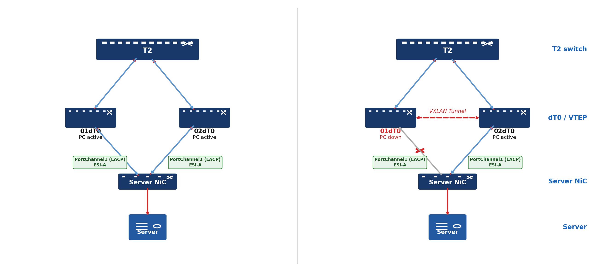
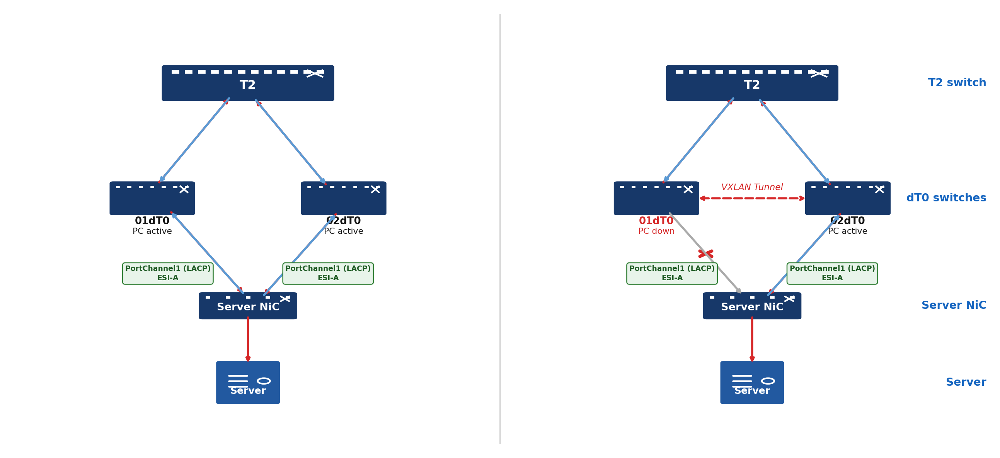
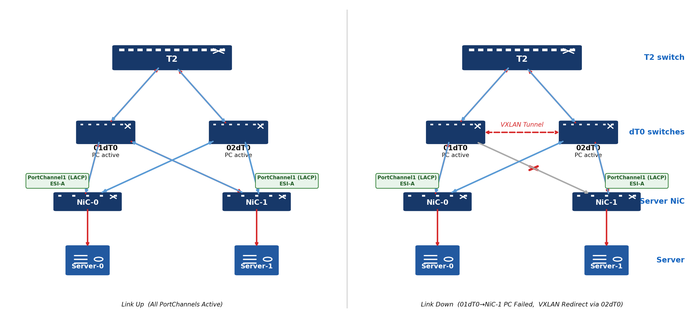

# BGP EVPN multihoming test plan

## overview
This project flattens Azure's data center network by removing Top-of-Rack (ToR) switches and directly connecting server NICs to middle-of-row dT0 switches. Each server NIC connects via max 8 independent links to 8 different dT0s, all running in active mode. BGP EVPN Multihoming (per RFC 7432 and RFC 8365) is the control-plane mechanism that provides high availability, loop-free forwarding, and fast failover across this topology. It simplifies the network topology, reduces the network latency (fewer hops from NIC to NIC), improves the network resiliency.

This test plan will primarily focus on two active-active links. It covers end-to-end verification of EVPN Multihoming correctness on SONiC switches.

## scope

**In scope:**
The scope of the test plan is to verify correct end-to-end operation of a running active-active two dT0s setup with fully functioning configuration:
* control plane verification: the correctness of the dT0s' state and the state transitions.
* EVPN Type-1 (AD-per-ES) route advertisement/withdrawal, including mass-withdrawal-driven convergence
* EVPN Type-2 (MAC/IP) advertisement for newly learned hosts and per-host ARP/ND aging.
* Data plane: the correctness of traffic flow including both upstream and downstream.

The following are out of scope for this test plan:
* the server NIC operation
* Individual component behavior(i.e. the CLI commands)
* Split horizon — not applicable in this design
* linkmgrd / mux simulator / NIC simulator — replaced by LACP
* Inter-VRF failures (T2-layer redundancy is assumed sufficient)

## testbed setup
The 2 dT0s active-active testbed setup is similar to dualtor testbed setup.
For the general SONiC testbed architecture (tiers, test servers, and neighbor simulation), see the [SONiC testbed overview](https://github.com/sonic-net/sonic-mgmt/blob/master/docs/testbed/README.testbed.Overview.md).

* The NIC on server will be connected to both dT0s.
    * Both dT0s are active, the server NIC will send/receive traffic via all uplinks.
    * If either of the dT0 goes standby, the server NIC will send/receive the traffic via uplink to the other dT0.
    * In dT0, all ports connecting to server live within a single /24 IPv4 VLAN and /64 IPv6 VLAN. The VLAN IP ranges will be advertised into the network by the dT0s directly.
* For a server, if one of the dT0s goes standby (for example, the server-facing LAG goes down), it withdraws its Type-1 AD-per-ES route (mass withdrawal covering all hosts behind the ES).   T2 has only the subnet route, which 01dT0 keeps advertising, so while the link remains down T2 keeps sending 01dT0 its share of the server's traffic. 01dT0 tunnels that share to 02dT0 (VXLAN packets 01dT0→02dT0 are observed) for the whole outage, and the server receives all packets. After link recovery, 01dT0 delivers locally, with no tunnel packets and load-balancing across both dT0s.

## server NIC
The testcases defined here are under the assumptions that the server NIC is functioning correctly:
- The server NIC could send/receive traffic via uplinks to the active dT0s.

As the testing of a server NIC device operation is out of the scope of this test plan, the testcases described here needs a server NIC simulator to operate with those functional requirements listed above. In order to validate those functionalities, there should be a pretest sanity check to verify the server NIC could operates properly.

**Key topology details:**
- **2 dT0 SONiC switches** (VTEPs), each running EVPN in the same VRF with the L3VNI bound to the default VRF
- **Shared across dT0 set**: same anycast gateway IP/MAC, same eBGP ASN, same system-mac (for ESI auto-derivation)
- **LACP**: each dT0 has one Port-Channel per simulated server (`PortChannel1` for the first server; further servers use `PortChannel2` and so on, each with its own ESI). Both dT0s present the same LACP system ID, set by the PortChannel (`system_mac`).
- **ESI**: auto-derived from system-mac + port-channel ID, or statically configured; same ESI across all dT0s for a given Server NIC
- **Server NIC simulator**: PTF simulating one or more servers, each with one LAG bundling one member to each dT0, LACP enabled.
- **T2 simulators**: cEOS nodes acting as upstream eBGP peers
- **Traffic generator**: PTF / scapy

### Testbed Assumptions
- EVPN routes are exchanged between both dT0s via T2.
- Server simulator supports LACP (active or passive mode) on its single LAG, which has one member link to each dT0.
- Required processes are running: `bgpd` in the BGP container, and `orchagent` (which contains NeighOrch) and `neighsyncd` in the SWSS container.
- LACP fast rate (1 s PDUs, 3 s timeout) is configured on both dT0s and the server simulator.
- dT0s learn each other's routes only through T2, so each drops the other's routes (its own ASN is in the AS path), unless allowas-in is set (IPv4, IPv6, L2VPN EVPN) or T2 uses as-override.
- The server VLAN interface on both dT0s has static_anycast_gateway enabled, uses the same gateway_mac, and has proxy ARP/ND enabled. In addition, all server-facing PortChannels in that VLAN are configured with the platform-supported L2 port-isolation feature (same setting on both dT0s) so traffic is not bridged directly between server-facing PortChannels. Under this isolation, inter-server resolution/forwarding in the SS scenarios is expected to occur via the anycast gateway path (routed), not direct L2 bridging.
- Pretest sanity check (before SS cases):
    * From Server-0, resolve Server-1 IP and confirm anycast gateway MAC is used (not Server-1 MAC).
    * On Server-1 link capture, confirm no direct ARP/NS or unicast frames from Server-0 are bridged.
    * Verify Server-0 -> Server-1 probe is routed (TTL/Hop-Limit decrement observed).
    * If any check fails, mark SS prerequisite failed and do not run SS functional checks.
- BGP graceful restart (GR) is disabled on all sessions; BFD is not used.

**BGP peering:** each dT0 runs eBGP sessions to the T2 simulators carrying the IPv4 unicast, IPv6 unicast and L2VPN EVPN address families. T2 propagates the EVPN routes between the two dT0s. The VXLAN tunnel is between the two dT0 VTEPs.

### Convergence & Detection Targets
**Target release and failover model:** this plan covers the release **without UAP** (the upcoming feature where a dT0 stops attracting traffic for the servers behind its failed link) and without hardware fast reroute. T2 has only the subnet route, so it keeps sending 01dT0 its share of a server's traffic after 01dT0 loses its link; withdrawing the Type-1 does not change that. 01dT0 tunnels that share to 02dT0 until the link recovers. The dT0 that lost its link moves traffic in software (tens to hundreds of ms).
**Pass/fail loss criteria:**
* For a single link failure, measure loss from fault injection through detection and forwarding convergence, using the failure-specific loss budgets in the table below (including the LACP timeout where applicable).
* Two or more link failures on the path lose traffic until the network converges (see DS-16, US-13, SS-13).
* For multiple link failures with a surviving end-to-end path, traffic resumes after convergence. If all server links fail (DS-16, US-13, SS-13), delivery remains unavailable until at least one link is restored; verify the specified drop/no-loop behavior during the outage.
* Timers (LACP fast rate with 1 s PDUs and a 3 s timeout, BGP hold time) are taken from the testbed configuration.

| Failure class | Detection mechanism | Detection time | Expected traffic loss |
|---|---|---|---|
| Link/member failure (LAG member/PortChannel admin down) | Immediate link-down notification (no LACP timeout needed — physical/admin down is detected instantly) | < 1s | ≤ 500 ms |
| LACP peer timeout (server stops sending PDUs) | LACP timeout | ~3s | 3.5 s (3 s detection + 500 ms) |
| Node reboot / power loss on 01dT0 | Loss of carrier on 01dT0's links (NIC drops its members, T2 stops forwarding over dead links at once) | Links: immediate; | ≤ 500 ms; traffic does not wait for the hold timer |
| BGP process kill on 01dT0 | TCP session close seen by peers immediately (GR disabled, so routes are withdrawn) | Immediate | ≤ 500 ms |
| Graceful shutdown (BGP NOTIFICATION) | BGP NOTIFICATION received | < 1 s | ≤ 500 ms |
| Core isolation: uplinks shut down | Link-down on the uplinks (immediate) | < 1 s | ≤ 500 ms; 01dT0 takes its server links out of service and the server stops using its member to 01dT0 |
| Frozen bgpd (SIGSTOP) or T2 session left up after node loss | BGP hold timer (90 s by default) | Hold timer | T2 keep the routes until expiry (and keeps advertising them to 02dT0); traffic does not wait for it |

---

## testcases
These testcases are to verify the traffic flow behaviors as expected following the configuration changes or dT0 state changes.
For all testcases in the packet flow scenario:
* Both dT0s are active initially.
* For cases that require the surviving dT0 to retain host state after the failed dT0 withdraws its Type-2, first learn each affected host locally on the surviving dT0 and verify that it is not relying solely on a synced copy. Baseline sync-only cases are exempt from this precondition.
**Neighbor-removal procedure (used by the cases that say "neighbor removal"):**
1. With the PortChannel down on 01dT0, wait past the aging time (set `base_reachable_time_ms` short; the SONiC default is 30 minutes). Expiry alone is not treated as removal.
2. Delete the host's neighbor entry on 01dT0 explicitly (for example `ip neigh del <ip> dev <vlan>`), so removal is deterministic and distinct from natural aging.
3. Poll until both hold, within the removal timeout configured for the testbed: (a) `show arp` / `show ndp` on 01dT0 has no entry for the host, and (b) `show bgp l2vpn evpn route type macip` on 02dT0 has no Type-2 from 01dT0 for the host. If either is not met within the timeout, the case fails.
4. Only after step 3 passes, run the Phase 2 checks and then restore the PortChannel (recovery cases). For DS-13, step 3 must hold for all N hosts.

## 1. Downstream Traffic Verification

| #     | Case                                             | Goal                                                 | Test Steps                                                       | Action During I/O                           | Expected Control Plane                                                                                                                                                                                        | Expected Data Plane                                                                 |
|-------|--------------------------------------------------|------------------------------------------------------|------------------------------------------------------------------|---------------------------------------------|---------------------------------------------------------------------------------------------------------------------------------------------------------------------------------------------------------------|-------------------------------------------------------------------------------------|
| DS-01 | Baseline — both dT0s (01dT0 and 02dT0) active                        | Verify normal active-active operation                | Start downstream I/O                                             | None                                        | Both dT0s active. dT0s share identical ESI to shared segment. Both dT0s advertise Type-1 AD-per-ES. The server ARP/ND entry learned on one dT0 is synced to the peer. Confirmed via `show bgp l2vpn evpn route type ead` on both dT0s (AD-per-ES present on both) and `show arp` / `show ndp` on both dT0s. On 02dT0 (the dT0 that did not learn the host) the host MAC is pinned as a static entry on its local PortChannel, in APPL_DB VXLAN_FDB_TABLE and ASIC_DB.                                                                        | Server receives packets, load-balanced across both dT0s. dT0s receive no VXLAN tunnel packets.         |
| DS-02 | LAG down on 01dT0                                 | Verify packet flow after PortChannel down            | Start downstream I/O | Bring down PortChannel on 01dT0. Then keep the PortChannel down and run the neighbor-removal procedure, then check again.                                         | 01dT0 becomes standby/unhealthy and withdraws its Type-1 AD-per-ES for the shared ESI (mass withdrawal covering all hosts behind the ES). 02dT0 keeps the server ARP/ND entry. Confirmed via `show bgp l2vpn evpn route type ead` on 01dT0 (AD-per-ES absent) and `show arp` / `show ndp` on 02dT0 (server ARP/ND entry present). After the aging time: 01dT0's own entry is gone and its Type-2 is withdrawn, but 02dT0 still has the host entry and its forwarding pin (its synced copy is removed only if 02dT0 did not learn the host itself).                                                                                          | T2 keeps sending 01dT0 its share of the traffic, and 01dT0 tunnels it to 02dT0 (VXLAN 01dT0→02dT0 observed) until the link recovers. The server receives packets. After the aging time: traffic is still tunneled 01dT0→02dT0 and delivered. |
| DS-03 | LAG up on 01dT0 after LAG down                    | Verify packet flow when PortChannel up after down    | Start downstream I/O  | 1. Bring down PortChannel on 01dT0. 2. Keep the PortChannel down and run the neighbor-removal procedure, then check again 3. Admin up PortChannel (01dT0 ↔ server NIC) and check again. | **Phase 1 (PortChannel down, before aging):** 01dT0 becomes standby/unhealthy and withdraws its Type-1 AD-per-ES for the shared ESI (mass withdrawal covering all hosts behind the ES). 02dT0 keeps the server ARP/ND entry.   **Phase 2 (PortChannel still down, after aging):** 01dT0's own entry is gone and its Type-2 is withdrawn, but 02dT0 still has the host entry and its forwarding pin (its synced copy is removed only if 02dT0 did not learn the host itself).   **Phase 3 (after PortChannel up, final state):** 01dT0 re-advertises its Type-1 AD-per-ES for the shared ESI, and the server ARP/ND entry is restored on 01dT0 (this must hold regardless of the Phase 2 aging). Confirmed via `show bgp l2vpn evpn route type ead` on 01dT0 (absent in phases 1–2, present in phase 3) and `show arp` / `show ndp` on 02dT0 (present in phases 1–2) and on 01dT0 (absent after aging, restored in phase 3).                                                                                  | **Phase 1 (down, before aging):** T2 keeps sending 01dT0 its share of the traffic, and 01dT0 tunnels it to 02dT0 (VXLAN 01dT0→02dT0 observed) until the link recovers. The server receives packets.   **Phase 2 (down, after aging):** traffic is still tunneled 01dT0→02dT0 and delivered.   **Phase 3 (after PortChannel up, final state):** no VXLAN tunnel packets; traffic load-balances across both dT0s. |
| DS-04 | LAG member down — LAG goes down                  | Verify packet flow after member port down            | Start downstream I/O | Bring down member port of PortChannel on 01dT0. Then keep the PortChannel down and run the neighbor-removal procedure, then check again.                                 | 01dT0 becomes standby/unhealthy and withdraws its Type-1 AD-per-ES for the shared ESI (mass withdrawal covering all hosts behind the ES). 02dT0 keeps the server ARP/ND entry. Confirmed via `show bgp l2vpn evpn route type ead` on 01dT0 (AD-per-ES absent) and `show arp` / `show ndp` on 02dT0 (server ARP/ND entry present). After the aging time: 01dT0's own entry is gone and its Type-2 is withdrawn, but 02dT0 still has the host entry and its forwarding pin (its synced copy is removed only if 02dT0 did not learn the host itself).                                                                                                                                            | T2 keeps sending 01dT0 its share, and 01dT0 tunnels it to 02dT0 (VXLAN 01dT0→02dT0 observed) until the link recovers; the server receives packets. After the aging time: traffic is still tunneled 01dT0→02dT0 and delivered.|
| DS-05 | LACP timeout (3s) on 01dT0 — server stops sending PDUs | Verify 01dT0 detects peer timeout and brings the LAG down | Start downstream I/O |  Stop LACP PDUs and drop all data between the server's member and 01dT0 (e.g. block that PTF port in both directions). Then keep the PortChannel down past the neighbor aging time (..set `base_reachable_time_ms` short short; the SONiC default is 30 minutes) and check again. | After ~3 s (3 missed 1 s PDUs), 01dT0 removes the member from LACP aggregation. As it is the only member, PortChannel1 goes down, 01dT0 becomes standby/unhealthy and withdraws its Type-1 AD-per-ES for the shared ESI (mass withdrawal covering all hosts behind the ES). 02dT0 keeps the server ARP/ND entry. Confirmed via `show bgp l2vpn evpn route type ead` on 01dT0 (AD-per-ES absent) and `show arp` / `show ndp` on 02dT0 (server ARP/ND entry present). After the aging time: 01dT0's own entry is gone and its Type-2 is withdrawn, but 02dT0 still has the host entry and its forwarding pin (its synced copy is removed only if 02dT0 did not learn the host itself). | Before the member leaves the bundle (~3 s), traffic hashed to 01dT0 is lost because data is dropped. After that, T2 keeps sending 01dT0 its share, and 01dT0 tunnels it to 02dT0 (VXLAN 01dT0→02dT0 observed) until the link recovers. The server receives packets. After the aging time: traffic is still tunneled 01dT0→02dT0 and delivered. |
| DS-06 | 01dT0 BGP graceful shutdown / startup | Verify packet flow on admin BGP shutdown/startup | Start downstream I/O | Admin shutdown/startup BGP sessions on 01dT0 | Shutdown: 01dT0 becomes standby, sends BGP NOTIFICATION, and withdraws its Type-1 AD-per-ES for the shared ESI (mass withdrawal covering all hosts behind the ES). Shutting every BGP session removes 01dT0's default route, so 01dT0 takes its server links out of service. Server side: the server's member to 01dT0 has left the aggregation and the server stops using it. 02dT0 keeps the server ARP/ND entry.   Startup: 01dT0 becomes active, re-establishes sessions, and re-advertises its Type-1 AD-per-ES; its server links stay out of service until it can forward, then come back (assert on 01dT0 and on the server). Confirmed via `show bgp l2vpn evpn route type ead`  on 01dT0 (absent on shutdown, re-appears after startup), `show ip bgp neighbor` for the NOTIFICATION/re-establish transition, and `show arp` / `show ndp` on 02dT0 (entry present during shutdown). | During shutdown: traffic is redistributed to 02dT0; 01dT0 not used.   After startup: no VXLAN tunnel packets; traffic load-balances across both dT0s. |
| DS-07 | 01dT0 kill BGP process | Verify packet flow after ungraceful BGP kill | Start downstream I/O | Kill BGP process on 01dT0 | Session type: eBGP to T2; GR disabled. The killed bgpd closes its TCP sessions, so T2 see the drop immediately and withdraw 01dT0's routes (including the Type-1 AD-per-ES), and propagates the withdrawal to 02dT0; they do not wait for the hold timer. Default route is lost and server links are taken out of service. Server side: the server's member to 01dT0 has left the aggregation and the server stops using it. Confirmed via `show bgp l2vpn evpn route type ead` on 02dT0 (withdrawn immediately), `show ip bgp summary` for the session state/uptime reset, and `show arp` / `show ndp` on 02dT0 (entry present). On recovery: BGP re-establishes and the Type-1 AD-per-ES is re-advertised. | Loss ≤ 500 ms; Server receives packets via 02dT0. After recovery: no VXLAN tunnel packets; traffic load-balances across both dT0s. |
| DS-08 | 01dT0 reboot | Verify packet flow during/after 01dT0 reboot | Start downstream I/O | Reboot 01dT0 | 01dT0's links go down: the NIC drops its member on loss of carrier and T2 stops forwarding over the dead links at once. Uplink eBGP sessions drop with the links. During shutdown 01dT0 may close its BGP sessions or send a NOTIFICATION, in which case T2 withdraws 01dT0's routes, including the Type-1 AD-per-ES, and propagates the withdrawal to 02dT0 at that point. If no teardown is seen, T2's BGP sessions to 01dT0 stay up until the hold timer expires (90 s by default) and T2, and therefore 02dT0, keep 01dT0's EVPN routes until then. Either way traffic does not wait for the withdrawal, because the links are already down. Confirmed via `show bgp l2vpn evpn route type ead` on 02dT0 (withdrawn at session teardown if one is observed; otherwise only after hold-timer expiry, with a timestamped withdrawal gap ≈ hold timer), `show ip bgp summary` for the session state/uptime reset, and `show arp` / `show ndp` on 02dT0 (entry present). On reboot: A starting dT0 keeps its server links out of service until it can forward (BGP/EVPN sessions Established, default route and EVPN routes installed); the server links then come back in service and the AD-per-ES is re-advertised. Loss is measured while the links come back. Assert on 01dT0 that server links stay out of service until it can forward. | During reboot: loss ≤ 500 ms; Server receives packets via 02dT0. After reboot: no VXLAN tunnel packets; traffic load-balances across both dT0s; loss while server links come back ≤ 500 ms. |
| DS-09 | 01dT0 config reload | Verify packet flow during/after config reload | Start downstream I/O | Issue config reload on 01dT0 | During reload: 01dT0 becomes standby, sends BGP NOTIFICATION, the PortChannel is briefly down, and its Type-1 AD-per-ES is withdrawn (mass withdrawal covering all hosts behind the ES).  After reload: 01dT0 keeps its server links out of service until it can forward (BGP/EVPN sessions Established, default route and EVPN routes installed); assert this on 01dT0 and on the server. The links then come back in service, LACP and BGP are restored, the server ARP/ND entry is re-learned; the Type-1 AD-per-ES is re-advertised. Confirmed via `show bgp l2vpn evpn route type ead`  on 01dT0 (absent during reload, re-appears after), `show ip bgp summary` for session re-establishment, and `show arp` / `show ndp` on 02dT0 (entry present during reload) and on 01dT0 (entry re-learned after). | During reload: server receives packets via 02dT0; 01dT0 not used.  After reload: no VXLAN tunnel packets; traffic load-balances across both dT0s. |
| DS-10 | 01dT0 neighbor age-out / removal | Verify the end states when the server entry on 01dT0 ages out or is removed | Start downstream I/O | (a) Set the neighbor aging time to 60 s and keep I/O running. (b) Delete the server's neighbor entry on 01dT0 by hand, or block the server's ARP/ND replies only on its link to 01dT0. Do not suppress replies server-wide: that also stops 02dT0 refreshing its entry. | (a) With I/O running the server stays live, so its entry on 01dT0 goes stale and is refreshed, not removed: no Type-2 withdrawal or re-advertisement and Type-1 AD-per-ES unchanged. (b) Once the entry is removed on 01dT0, its Type-2 is withdrawn; 02dT0 then drops its synced copy and forwarding pin unless 02dT0 learned the host itself, in which case it keeps them. Assert these end states only, not a withdraw-then-re-advertise order (BGP does not order this across dT0s). Confirmed via `show arp` / `show ndp` on both dT0s, `show bgp l2vpn evpn route type macip` and `show bgp l2vpn evpn route type ead` (unchanged). | (a) No traffic loss; no VXLAN tunnel packets. (b) If 02dT0 learned the host, traffic is still delivered; otherwise traffic for the host is dropped until it is re-learned. |
| DS-11 | Core isolation: node cast-out on 01dT0 | Verify that when 01dT0 loses its path to the core, it takes its server links out of service | Start downstream I/O | Shut down all 01dT0 ↔ T2 uplinks (default route lost) | Trigger: uplinks shut down, which is a link-down event, so detection is immediate. 01dT0 loses its default route, and the cast-out action takes the server links out of service (PortChannel1 down, or LACP OOS). 01dT0's Type-1 AD-per-ES is withdrawn (mass withdrawal covering all hosts behind the ES). Server side: the server's member to 01dT0 has left the aggregation and the server stops using it. 02dT0 keeps the server ARP/ND entry.   Confirmed via `show ip route 0.0.0.0/0` on 01dT0 (absent), `show interfaces portchannel` on 01dT0 (PortChannel1 down or LACP OOS),  `show bgp l2vpn evpn route type ead` on 02dT0 (AD-per-ES from 01dT0 absent, from 02dT0 present) | No downstream traffic is black-holed at 01dT0; all downstream traffic is forwarded via 02dT0. Loss ≤ 500 ms |
| DS-12 | Host mobility: host moves between ESIs on the dT0 pair | Verify that when a host moves from PortChannel1 (ESI-A) to PortChannel2 (ESI-B) on the dT0 pair, the fabric converges on the new location | - Add a second port-channel (PortChannel2) on both 01dT0 and 02dT0 with its own distinct ESI (ESI-B), separate from PortChannel1 (ESI-A);  every server attaches to every dT0   - Start downstream I/O to a known server host IP learned behind PortChannel1 (ESI-A). | Without withdrawing PortChannel1 or its Type-1, move the host from PortChannel1 (ESI-A) to PortChannel2 (ESI-B) on the dT0 pair (stop answering on the old interface, answer on the new one, send a GARP/unsolicited NA). | Assert on **each** dT0: the host is on PortChannel2 (ESI-B) and not on PortChannel1. Every Type-2 for the host carries ESI-B, whichever dT0 originates it (do not assert a specific next hop). Type-1 AD-per-ES for both ESIs is unchanged. Confirmed via `show bgp l2vpn evpn route type macip` on 01dT0, 02dT0  (ESI = ESI-B on every entry), `show arp` / `show ndp` on both dT0s (host entry on PortChannel2, none on PortChannel1), and `show bgp l2vpn evpn route type ead` (unchanged). | The server receives all packets. After convergence both dT0s deliver the host's traffic locally on PortChannel2 (T2 may send via either), and there are no VXLAN tunnel packets. |
| DS-13 | Server ARP/ND entry scale — LAG down on 01dT0 with N server ARP/ND entries behind the shared ESI | Verify all N server ARP/ND entries remain on 02dT0 and convergence time does not scale linearly with N | 1. Repeat the case for several host counts (e.g. N = 10, 100, 1000, as the testbed allows). For each N, learn N server IPs behind the shared ESI via 01dT0/02dT0.   2. Start downstream I/O to all N IPs.   3. Bring down PortChannel on 01dT0 | Bring down PortChannel on 01dT0. Then keep the PortChannel down and run the neighbor-removal procedure, then check again. | 01dT0 withdraws a single Type-1 AD-per-ES for the shared ESI (mass withdrawal covering all N hosts). 02dT0 keeps all N server ARP/ND entries. Confirmed via `show bgp l2vpn evpn route type ead` on 01dT0 (absent) and `show arp` / `show ndp` on 02dT0 (N entries present). After the aging time: 01dT0's own entry is gone and its Type-2 is withdrawn, but 02dT0 still has the host entry and its forwarding pin (its synced copy is removed only if 02dT0 did not learn the host itself). | T2 keeps sending 01dT0 its share of the N flows, and 01dT0 tunnels it to 02dT0 (VXLAN 01dT0→02dT0 observed) until the link recovers; servers receive packets. After the aging time: traffic is still tunneled 01dT0→02dT0 and delivered.|
| DS-14 | Anycast gateway ARP/ND | Verify each dT0 answers ARP/ND for the anycast gateway IP locally, with the anycast MAC | Send an ARP request (or ND NS) for the anycast gateway IP through each server LAG member in turn, testing each dT0 separately | None | Each dT0 answers locally. Confirmed via `ip neigh show <gateway_ip>` on the server (gateway MAC equals the anycast MAC). On each dT0, the gateway IP is configured as a local address on the VLAN interface (`show ip interfaces` / `show ipv6 interfaces`). | Reply source MAC is the shared anycast gateway MAC configured on both dT0s (not the dT0's physical MAC). For each probe, capture the request and reply on the tested dT0's server-facing link; no copies of that exchange appear on the VXLAN tunnel or the other dT0's server-facing ports. |
| DS-15 | Unresolved server IP | Verify traffic to an unresolved IP is dropped, with no ARP-triggered flooding over VXLAN | Send traffic to a server-VLAN IP that has never been learned by either dT0 | None | No server ARP/ND entry and no Type-2 route exist for the destination IP. Confirmed via `show arp` / `show ndp` on both dT0s and `show bgp l2vpn evpn route type macip` (no route for the IP). | Traffic is dropped; no ARP/ND or traffic for the IP is sent over VXLAN, and no forwarding loop. ARP/ND requests appear only on server-facing ports. |
| DS-16 | Both links of the same server down | Verify that with both dT0s withdrawing the RT-1 for a server, traffic for it is dropped and never bounced back over the tunnel | Start downstream I/O | Bring down the server's PortChannel on 01dT0 and on 02dT0: (a) one after the other, (b) together. | Once both dT0s have withdrawn the Type-1 AD-per-ES for the server's ESI, no dT0 has a path to the server. Confirmed via `show bgp l2vpn evpn route type ead` on both dT0s (absent from both), and `show arp` / `show ndp` after neighbor aging. | (a) After the first link is down, traffic is carried via the tunnel until the second goes down. After both are down, traffic for the server is dropped at the dT0 that receives it. (b) Same final state. At no point does a dT0 send protection traffic it received over the tunnel back over the tunnel (no VXLAN packet is re-tunneled; loop-free). |
| DS-17 | 01dT0 bgpd frozen (SIGSTOP) | Verify behaviour when a session stays up but bgpd stops responding | Start downstream I/O | Send SIGSTOP to bgpd on 01dT0, then SIGCONT after the hold timer expires | Session type: eBGP to T2; GR disabled. The TCP sessions stay up, so T2 keep 01dT0's EVPN routes (including the Type-1 AD-per-ES) until the hold timer expires ( 90 s by default). Confirmed via `show bgp l2vpn evpn route type ead` on 02dT0 (present until hold-timer expiry, then withdrawn; timestamped gap ≈ hold timer) and `show ip bgp summary`. | Server links stay up and the data plane keeps forwarding; traffic does not wait for the hold timer. Loss, if any, occurs only after T2 withdraws 01dT0's routes at hold-timer expiry (propagated to 02dT0). After SIGCONT: sessions re-establish and traffic load-balances across both dT0s. |

## 2. Upstream Traffic Verification

| #     | Case                                     | Goal                                                 | Test Steps                                                           | Action During I/O                           | Expected Control Plane                                                                                                                                                             | Expected Data Plane                                                       |
|-------|------------------------------------------|------------------------------------------------------|----------------------------------------------------------------------|---------------------------------------------|------------------------------------------------------------------------------------------------------------------------------------------------------------------------------------|---------------------------------------------------------------------------|
| US-01 | Baseline — both dT0s (01dT0 and 02dT0) active | Verify normal active-active operation | Start upstream I/O | None | Both dT0s active. dT0s share the identical ESI for the shared segment. Both dT0s advertise Type-1 AD-per-ES. The server ARP/ND entry learned on one dT0 is synced to the peer. Confirmed via `show bgp l2vpn evpn route type ead`  on both dT0s (AD-per-ES present on both) and `show arp` / `show ndp` on both dT0s (server ARP/ND entry present). On 02dT0 (the dT0 that did not learn the host) the host MAC is pinned as a static entry on its local PortChannel, in APPL_DB VXLAN_FDB_TABLE and ASIC_DB. | Both dT0s receive packets. dT0s receive no VXLAN tunnel packets. |
| US-02 | LAG down on 01dT0 | Verify packet flow after PortChannel down | Start upstream I/O | Bring down PortChannel on 01dT0. Then keep the PortChannel down and run the neighbor-removal procedure, then check again. | 01dT0 becomes standby/unhealthy and withdraws its Type-1 AD-per-ES for the shared ESI (mass withdrawal covering all hosts behind the ES). 02dT0 keeps the server ARP/ND entry. Confirmed via `show bgp l2vpn evpn route type ead` on 01dT0 (AD-per-ES absent) and `show arp` / `show ndp` on 02dT0 (server ARP/ND entry present). After the aging time: 01dT0's own entry is gone and its Type-2 is withdrawn, but 02dT0 still has the host entry and its forwarding pin (its synced copy is removed only if 02dT0 did not learn the host itself). | Upstream traffic that reaches 01dT0 (server LAG hashing, or traffic in flight) is not dropped. With 01dT0's PortChannel down, the server sends all its traffic on its member to 02dT0, which routes it to T2. T2 receives packets, and only the packets in flight at the failure are lost. No traffic is forwarded via 01dT0. After the aging time: the same, upstream traffic still goes via 02dT0. |
| US-03 | LAG up on 01dT0 after LAG down | Verify packet flow when PortChannel up after down | Start upstream I/O | 1. Bring down PortChannel on 01dT0.  2. Keep the PortChannel down and run the neighbor-removal procedure, then check again   3. Admin up PortChannel (01dT0 ↔ server NIC) and check again. | **Phase 1 (PortChannel down, before aging):** 01dT0 becomes standby/unhealthy and withdraws its Type-1 AD-per-ES for the shared ESI (mass withdrawal covering all hosts behind the ES). 02dT0 keeps the server ARP/ND entry.   **Phase 2 (PortChannel still down, after aging):** 01dT0's own entry is gone and its Type-2 is withdrawn, but 02dT0 still has the host entry and its forwarding pin (its synced copy is removed only if 02dT0 did not learn the host itself).   **Phase 3 (after PortChannel up, final state):** 01dT0 re-advertises its Type-1 AD-per-ES for the shared ESI, and the server ARP/ND entry is restored on 01dT0 (this must hold regardless of the Phase 2 aging). Confirmed via `show bgp l2vpn evpn route type ead` on 01dT0 (absent in phases 1–2, present in phase 3) and `show arp` / `show ndp` on 02dT0 (present in phases 1–2) and on 01dT0 (absent after aging, restored in phase 3). | **Phase 1 (down, before aging):** the server sends all its traffic on its member to 02dT0, and T2 receives packets (only packets in flight at the failure are lost); no traffic is forwarded via 01dT0.   **Phase 2 (down, after aging):** upstream traffic still goes via 02dT0.   **Phase 3 (after PortChannel up, final state):** no VXLAN tunnel packets; traffic load-balances across both dT0s. |
| US-04 | LAG member down — LAG goes down | Verify packet flow after member port down | Start upstream I/O | Bring down member port of PortChannel on 01dT0. Then keep the PortChannel down and run the neighbor-removal procedure, then check again. | 01dT0 becomes standby/unhealthy and withdraws its Type-1 AD-per-ES for the shared ESI (mass withdrawal covering all hosts behind the ES). 02dT0 keeps the server ARP/ND entry. Confirmed via `show bgp l2vpn evpn route type ead` on 01dT0 (AD-per-ES absent) and `show arp` / `show ndp` on 02dT0 (server ARP/ND entry present). After the aging time: 01dT0's own entry is gone and its Type-2 is withdrawn, but 02dT0 still has the host entry and its forwarding pin (its synced copy is removed only if 02dT0 did not learn the host itself). | With 01dT0's PortChannel down, the server sends all its traffic on its member to 02dT0, which routes it to T2. T2 receives packets (only packets in flight at the failure are lost); no traffic is forwarded via 01dT0. After the aging time: the same, upstream traffic still goes via 02dT0. |
| US-05 | LACP timeout (3s) on 01dT0 — server stops sending PDUs and data | Verify 01dT0 detects peer timeout, takes the member out of the aggregation, and the LAG goes down | Start upstream I/O | Stop LACP PDUs and drop all data between the server's member and 01dT0 (e.g. block that PTF port in both directions).  Then keep the PortChannel down and run the neighbor-removal procedure, then check again. | After ~3 s (3 missed 1 s PDUs), 01dT0 removes the member from LACP aggregation. As it is the only member, PortChannel1 goes down, 01dT0 becomes standby/unhealthy and withdraws its Type-1 AD-per-ES for the shared ESI (mass withdrawal covering all hosts behind the ES). 02dT0 keeps the server ARP/ND entry. Server side: its member to 01dT0 has left the aggregation and the server stops using it. Confirmed via `show bgp l2vpn evpn route type ead` on 01dT0 (AD-per-ES absent) and `show arp` / `show ndp` on 02dT0 (server ARP/ND entry present). After the aging time: 01dT0's own entry is gone and its Type-2 is withdrawn, but 02dT0 still has the host entry and its forwarding pin (its synced copy is removed only if 02dT0 did not learn the host itself). | Before the member leaves the bundle (~3 s), traffic hashed to 01dT0 is lost because data is dropped. After that, the server sends all traffic via 02dT0 and T2 receives packets; no traffic is forwarded via 01dT0. After the aging time: upstream traffic goes via 02dT0. |
| US-06 | 01dT0 BGP graceful shutdown / startup | Verify packet flow on admin BGP shutdown/startup | Start upstream I/O | Admin shutdown/startup BGP sessions on 01dT0 | Shutdown: 01dT0 sends BGP NOTIFICATION and withdraws its Type-1 AD-per-ES for the shared ESI (mass withdrawal covering all hosts behind the ES). Shutting every BGP session removes 01dT0's default route, so 01dT0 takes its server links out of service. Server side: the server's member to 01dT0 has left the aggregation and the server stops using it. 02dT0 keeps the server ARP/ND entry.   Startup: 01dT0 re-establishes sessions and re-advertises its Type-1 AD-per-ES; its server links stay out of service until it can forward, then come back (assert on 01dT0 and on the server). Confirmed via `show bgp l2vpn evpn route type ead` on 01dT0 (absent on shutdown, re-appears after startup),  `show ip bgp neighbor` for the NOTIFICATION/re-establish transition, and `show arp` / `show ndp` on 02dT0 (entry present during shutdown). | During shutdown: traffic is redistributed to 02dT0; 01dT0 not used.  After startup: no VXLAN tunnel packets; traffic load-balances across both dT0s. |
| US-07 | 01dT0 kill BGP process | Verify packet flow after ungraceful BGP kill | Start upstream I/O | Kill BGP process on 01dT0 | Session type: eBGP to T2; GR disabled. The killed bgpd closes its TCP sessions, so T2 see the drop immediately and withdraw 01dT0's routes (including the Type-1 AD-per-ES), and propagates the withdrawal to 02dT0; they do not wait for the hold timer. Default route is lost and server links are taken out of service. Server side: the server's member to 01dT0 has left the aggregation and the server stops using it. Confirmed via `show bgp l2vpn evpn route type ead` on 02dT0 (withdrawn immediately),  show ip bgp summary  for the session state/uptime reset, and `show arp` / `show ndp` on 02dT0 (entry present). On recovery: BGP re-establishes and the Type-1 AD-per-ES is re-advertised. | Loss ≤ 500 ms; T2 receives packets via 02dT0. After recovery: no VXLAN tunnel packets; traffic load-balances across both dT0s. |
| US-08 | 01dT0 reboot | Verify packet flow during/after 01dT0 reboot | Start upstream I/O | Reboot 01dT0 | Session type: eBGP to T2; GR disabled; 01dT0's links go down: the NIC drops its member on loss of carrier and T2 stops forwarding over the dead links at once. Uplink eBGP sessions drop with the links. During shutdown 01dT0 may close its BGP sessions or send a NOTIFICATION, in which case T2 withdraws 01dT0's routes, including the Type-1 AD-per-ES, and propagates the withdrawal to 02dT0 at that point. If no teardown is seen, T2's BGP sessions to 01dT0 stay up until the hold timer expires (90 s by default) and T2, and therefore 02dT0, keep 01dT0's EVPN routes until then. Either way traffic does not wait for the withdrawal, because the links are already down. Confirmed via `show bgp l2vpn evpn route type ead` on 02dT0 (withdrawn at session teardown if one is observed; otherwise only after hold-timer expiry, with a timestamped withdrawal gap ≈ hold timer), `show ip bgp summary` for the session state/uptime reset, and `show arp` / `show ndp` on 02dT0 (entry present). On reboot: A starting dT0 keeps its server links out of service until it can forward (BGP/EVPN sessions Established, default route and EVPN routes installed); the server links then come back in service and the AD-per-ES is re-advertised. Loss is measured while the links come back. Assert on 01dT0 that server links stay out of service until it can forward. | During reboot: loss ≤ 500 ms; T2 receives packets via 02dT0. After reboot: no VXLAN tunnel packets; traffic load-balances across both dT0s; loss while server links come back ≤ 500 ms. |
| US-09 | 01dT0 config reload | Verify packet flow during/after config reload | Start upstream I/O | Issue config reload on 01dT0 | During reload: 01dT0 sends BGP NOTIFICATION, the PortChannel is briefly down, and its Type-1 AD-per-ES is withdrawn (mass withdrawal covering all hosts behind the ES).  After reload: 01dT0 keeps its server links out of service until it can forward (BGP/EVPN sessions Established, default route and EVPN routes installed); assert this on 01dT0 and on the server. The links then come back in service, LACP and BGP are restored, the server ARP/ND entry is re-learned; the Type-1 AD-per-ES is re-advertised. Confirmed via `show bgp l2vpn evpn route type ead` on 01dT0 (absent during reload, re-appears after), `show ip bgp summary` for session re-establishment, and `show arp` / `show ndp` on 02dT0 (entry present during reload) and on 01dT0 (entry re-learned after). | During reload: T2 receives packets only from 02dT0.   After reload: no VXLAN tunnel packets; traffic load-balances across both dT0s. |
| US-10 | 01dT0 neighbor age-out / removal | Verify the end states when the server entry on 01dT0 ages out or is removed | Start upstream I/O | (a) Set the neighbor reachable time to 60 s and keep upstream I/O running. (b) Delete the source server's neighbor entry on 01dT0. | (a) Reachable-time expiry alone does not imply neighbor removal or Type-2 withdrawal. The entry may become stale; do not require one-way upstream I/O to refresh it. Type-1 AD-per-ES remains unchanged. (b) Once the entry is removed on 01dT0, its Type-2 is withdrawn. 02dT0 drops its synced copy and forwarding pin unless it learned the host itself, in which case it keeps both. Assert the applicable state without requiring an ordering across dT0s. Confirm via `show arp` / `show ndp` on both dT0s and `show bgp l2vpn evpn route type macip`; confirm Type-1 remains unchanged via `show bgp l2vpn evpn route type ead`. | In both parts, upstream packets continue to reach T2 without VXLAN tunneling, even if neither dT0 retains the source server's ARP/ND entry. |
| US-11 | Core isolation: node cast-out on 01dT0 | Verify that when 01dT0 loses its path to the core, it takes its server links out of service | Start upstream I/O | Shut down all 01dT0 ↔ T2 uplinks (default route lost) | Trigger: uplinks shut down, which is a link-down event, so detection is immediate. 01dT0 loses its default route, and the cast-out action takes the server links out of service (PortChannel1 down, or LACP OOS). 01dT0's Type-1 AD-per-ES is withdrawn (mass withdrawal covering all hosts behind the ES). Server side: the server's member to 01dT0 has left the aggregation and the server stops using it. 02dT0 keeps the server ARP/ND entry.   Confirmed via  show ip route 0.0.0.0/0  on 01dT0 (absent), `show interfaces portchannel` on 01dT0 (PortChannel1 down or LACP OOS), `show bgp l2vpn evpn route type ead` on 02dT0 (AD-per-ES from 01dT0 absent, from 02dT0 present), and `show arp` / `show ndp` on 02dT0 (entry present). | No upstream traffic is black-holed at 01dT0. T2 receives packets via 02dT0. Loss ≤ 500 ms. |
| US-12 | Host mobility: host moves between ESIs on the dT0 pair | Verify that when a host moves from PortChannel1 (ESI-A) to PortChannel2 (ESI-B) on the dT0 pair, upstream traffic follows the new location | - Add a second port-channel (PortChannel2) on both 01dT0 and 02dT0 with its own distinct ESI (ESI-B), separate from PortChannel1 (ESI-A); every server attaches to every dT0. - Start upstream I/O from a known server host IP learned behind PortChannel1 (ESI-A). | Without withdrawing PortChannel1 or its Type-1, move the host from PortChannel1 (ESI-A) to PortChannel2 (ESI-B) on the dT0 pair (stop answering on the old interface, answer on the new one, send a GARP/unsolicited NA). | Assert on **each** dT0: the host is on PortChannel2 (ESI-B) and not on PortChannel1. Every Type-2 for the host carries ESI-B, whichever dT0 originates it (do not assert a specific next hop). Type-1 AD-per-ES for both ESIs is unchanged. Confirmed via `show bgp l2vpn evpn route type macip` on 01dT0, 02dT0  (ESI = ESI-B on every entry), `show arp` / `show ndp` on both dT0s (host entry on PortChannel2, none on PortChannel1), and `show bgp l2vpn evpn route type ead` (unchanged). | T2 receives all packets. After convergence the host's traffic arrives on both dT0s via PortChannel2, and there are no VXLAN tunnel packets. |
| US-13 | Both links of the same server down | Verify that with both of the server's links down, the server has no eligible LAG members and, after in-flight packets drain, no upstream packets reach T2 | Start upstream I/O | Bring down the server's PortChannel on 01dT0 and on 02dT0: (a) one after the other, (b) together. | Once both dT0s have withdrawn the Type-1 AD-per-ES for the server's ESI, no dT0 has a path to the server. Server side: no eligible LAG members remain. Confirmed via `show bgp l2vpn evpn route type ead` on both dT0s (absent from both), and `show arp` / `show ndp` after neighbor aging. | (a) After the first link goes down, the server uses its other link, with no tunnel, and T2 keeps receiving packets. After both are down, the server has no eligible LAG member, so no new packets reach either dT0 and, once in-flight packets drain, T2 receives none. (b) Same final state. No VXLAN tunnel packets are seen at any point. Drop and loop-prevention checks (a dT0 never re-tunnels protection traffic it received over the tunnel) are covered by DS-16, which injects downstream traffic. |
| US-14 | 01dT0 bgpd frozen (SIGSTOP) | Verify behaviour when a session stays up but bgpd stops responding | Start upstream I/O | Send SIGSTOP to bgpd on 01dT0, then SIGCONT after the hold timer expires | Session type: eBGP to T2; GR disabled. The TCP sessions stay up, so T2 keep 01dT0's EVPN routes (including the Type-1 AD-per-ES) until the hold timer expires ( 90 s by default). Confirmed via `show bgp l2vpn evpn route type ead` on 02dT0 (present until hold-timer expiry, then withdrawn; timestamped gap ≈ hold timer) and `show ip bgp summary`. | Server links stay up and the data plane keeps forwarding; traffic does not wait for the hold timer. Loss, if any, occurs only after T2 withdraws 01dT0's routes at hold-timer expiry (propagated to 02dT0). After SIGCONT: sessions re-establish and traffic load-balances across both dT0s. |     

## 3. Server-to-Server Traffic Verification

Server-0 uses PortChannel1 (ESI-A) and Server-1 uses PortChannel2 (ESI-B) on both dT0s. Unless explicitly stated otherwise, per-server PortChannel/member failures in this section target Server-1's PortChannel2, while Server-0's links remain up. Node-wide failures affect both servers.

| #     | Case                            | Goal                                              | Test Steps                                                       | Action During I/O                        | Expected Control Plane                                                                                                      | Expected Data Plane                                                                                   |
|-------|---------------------------------|---------------------------------------------------|------------------------------------------------------------------|------------------------------------------|-----------------------------------------------------------------------------------------------------------------------------|-------------------------------------------------------------------------------------------------------|
| SS-01 | Baseline — both dT0s (01dT0 and 02dT0) active | Verify normal active-active operation | Start server-to-server I/O (Server-0 → Server-1) | None | Both dT0s active. dT0s share the identical ESI for the shared segment. Both dT0s advertise Type-1 AD-per-ES. The server ARP/ND entry learned on one dT0 is synced to the peer.  Confirmed via `show bgp l2vpn evpn route type ead` on both dT0s (AD-per-ES present on both) and `show arp` / `show ndp` on both dT0s (server ARP/ND entry present). On 02dT0 (the dT0 that did not learn the host) the host MAC is pinned as a static entry on its local PortChannel, in APPL_DB VXLAN_FDB_TABLE and ASIC_DB. | Server-0's neighbor entry for Server-1 shows the anycast gateway MAC. Server-1 receives packets with source MAC = anycast MAC and TTL/hop limit decremented by 1 (routed, not bridged). No VXLAN tunnel packets between the dT0s. |
| SS-02 | LAG down on 01dT0 | Verify packet flow after PortChannel down | Start server-to-server I/O (Server-0 → Server-1) | Bring down PortChannel on 01dT0. Then keep the PortChannel down and run the neighbor-removal procedure, then check again. | 01dT0 becomes standby/unhealthy and withdraws its Type-1 AD-per-ES for the shared ESI (mass withdrawal covering all hosts behind the ES). 02dT0 keeps the server ARP/ND entry. Confirmed via `show bgp l2vpn evpn route type ead` on 01dT0 (AD-per-ES absent) and `show arp` / `show ndp` on 02dT0 (server ARP/ND entry present). After the aging time: 01dT0's own entry is gone and its Type-2 is withdrawn, but 02dT0 still has the host entry and its forwarding pin (its synced copy is removed only if 02dT0 did not learn the host itself). | Server-0's neighbor entry for Server-1 shows the anycast gateway MAC. Server-1 receives packets with source MAC = anycast MAC and TTL/hop limit decremented by 1 when delivered locally by the dT0 that received the packet, and by 2 when tunneled 01dT0→02dT0 (routed at both dT0s). During link down, Server-1 receives packets via VXLAN tunnel (01dT0→02dT0).   After the aging time: traffic is still tunneled 01dT0→02dT0 and delivered. |
| SS-03 | LAG up on 01dT0 after LAG down | Verify packet flow when PortChannel up after down | Start server-to-server I/O (Server-0 → Server-1) | 1. Bring down PortChannel on 01dT0.  2. Keep the PortChannel down and run the neighbor-removal procedure, then check again   3. Admin up PortChannel (01dT0 ↔ server NIC) and check again. | **Phase 1 (PortChannel down, before aging):** 01dT0 becomes standby/unhealthy and withdraws its Type-1 AD-per-ES for the shared ESI (mass withdrawal covering all hosts behind the ES). 02dT0 keeps the server ARP/ND entry.   **Phase 2 (PortChannel still down, after aging):** 01dT0's own entry is gone and its Type-2 is withdrawn, but 02dT0 still has the host entry and its forwarding pin (its synced copy is removed only if 02dT0 did not learn the host itself).   **Phase 3 (after PortChannel up, final state):** 01dT0 re-advertises its Type-1 AD-per-ES for the shared ESI, and the server ARP/ND entry is restored on 01dT0 (this must hold regardless of the Phase 2 aging). Confirmed via `show bgp l2vpn evpn route type ead` on 01dT0 (absent in phases 1–2, present in phase 3) and `show arp` / `show ndp` on 02dT0 (present in phases 1–2) and on 01dT0 (absent after aging, restored in phase 3). | Throughout: Server-0's neighbor entry for Server-1 shows the anycast gateway MAC, and Server-1 receives packets with source MAC = anycast MAC and TTL/hop limit decremented by 1 when delivered locally by the dT0 that received the packet, and by 2 when tunneled 01dT0→02dT0 (routed at both dT0s).   **Phase 1 (down, before aging):** Server-1 receives packets via the VXLAN tunnel (01dT0→02dT0).   **Phase 2 (down, after aging):** traffic is still tunneled 01dT0→02dT0 and delivered.   **Phase 3 (after PortChannel up, final state):** no VXLAN tunnel packets; traffic load-balances across both dT0s. |
| SS-04 | LAG member down — LAG goes down | Verify packet flow after member port down | Start server-to-server I/O (Server-0 → Server-1) | Bring down member port of PortChannel on 01dT0. Then keep the PortChannel down and run the neighbor-removal procedure, then check again. | 01dT0 becomes standby/unhealthy and withdraws its Type-1 AD-per-ES for the shared ESI (mass withdrawal covering all hosts behind the ES). 02dT0 keeps the server ARP/ND entry. Confirmed via `show bgp l2vpn evpn route type ead` on 01dT0 (AD-per-ES absent) and `show arp` / `show ndp` on 02dT0 (server ARP/ND entry present). After the aging time: 01dT0's own entry is gone and its Type-2 is withdrawn, but 02dT0 still has the host entry and its forwarding pin (its synced copy is removed only if 02dT0 did not learn the host itself). | Server-0's neighbor entry for Server-1 shows the anycast gateway MAC. Server-1 receives packets with source MAC = anycast MAC and TTL/hop limit decremented by 1 when delivered locally by the dT0 that received the packet, and by 2 when tunneled 01dT0→02dT0 (routed at both dT0s). While LAG member down, Server-1 receives packets via VXLAN tunnel (01dT0→02dT0). After the aging time: traffic is still tunneled 01dT0→02dT0 and delivered.|
| SS-05 | LACP timeout (3s) on 01dT0 — Server-1 stops sending PDUs and data | Verify 01dT0 detects Server-1's peer timeout, takes the member out of the aggregation, and PortChannel2 goes down | Start server-to-server I/O (Server-0 → Server-1) | Stop LACP PDUs and drop all data between Server-1's member and 01dT0 (e.g. block that PTF port in both directions). Server-0's links remain up. Then keep PortChannel2 down and run the neighbor-removal procedure, then check again | After ~3 s (3 missed 1 s PDUs), 01dT0 removes Server-1's member from LACP aggregation. As it is the only member, PortChannel2 goes down, 01dT0 becomes standby/unhealthy for ESI-B and withdraws its Type-1 AD-per-ES for ESI-B (mass withdrawal covering all hosts behind ESI-B). Server-0's PortChannel1 and its ESI-A Type-1 are unchanged. 02dT0 keeps the Server-1 ARP/ND entry. Server side: Server-1's member to 01dT0 has left the aggregation and Server-1 stops using it. Confirmed via `show bgp l2vpn evpn route type ead` on 01dT0 (ESI-B AD-per-ES absent, ESI-A present) and `show arp` / `show ndp` on 02dT0 (Server-1 ARP/ND entry present). After the aging time: 01dT0's own entry is gone and its Type-2 is withdrawn, but 02dT0 still has the host entry and its forwarding pin (its synced copy is removed only if 02dT0 did not learn the host itself). | Server-0's neighbor entry for Server-1 shows the anycast gateway MAC. Server-1 receives packets with source MAC = anycast MAC and TTL/hop limit decremented by 1 when delivered locally by the dT0 that received the packet, and by 2 when tunneled 01dT0→02dT0 (routed at both dT0s). Server-0 keeps sending on both of its links. Traffic arriving at 02dT0 is delivered locally to Server-1. Before the member leaves the bundle (~3 s), traffic arriving at 01dT0 for Server-1 is lost because data is dropped. After detection, traffic arriving at 01dT0 is tunneled to 02dT0 (VXLAN 01dT0→02dT0 observed) and delivered until the link recovers. After the aging time: traffic arriving at 01dT0 is still tunneled 01dT0→02dT0 and delivered. |
| SS-06 | 01dT0 BGP graceful shutdown / startup | Verify packet flow on admin BGP shutdown/startup | Start server-to-server I/O (Server-0 → Server-1) | Admin shutdown/startup BGP sessions on 01dT0 | Shutdown: 01dT0 becomes standby, sends BGP NOTIFICATION, and withdraws its Type-1 AD-per-ES for the shared ESI (mass withdrawal covering all hosts behind the ES). Shutting every BGP session removes 01dT0's default route, so 01dT0 takes its server links out of service. Server side: the server's member to 01dT0 has left the aggregation and the server stops using it. 02dT0 keeps the server ARP/ND entry.   Startup: 01dT0 becomes active, re-establishes sessions, and re-advertises its Type-1 AD-per-ES; its server links stay out of service until it can forward, then come back (assert on 01dT0 and on the server). Confirmed via `show bgp l2vpn evpn route type ead` on 01dT0 (absent on shutdown, re-appears after startup), `show ip bgp neighbor` for the NOTIFICATION/re-establish transition, and `show arp` / `show ndp` on 02dT0 (entry present during shutdown). | Server-0's neighbor entry for Server-1 shows the anycast gateway MAC. Server-1 receives packets with source MAC = anycast MAC and TTL/hop limit decremented by 1 (routed, not bridged). During shutdown: Server-1 receives packets via 02dT0; 01dT0 not used.  After startup: no VXLAN tunnel packets; traffic load-balances across both dT0s. |
| SS-07 | 01dT0 kill BGP process | Verify packet flow after ungraceful BGP kill | Start server-to-server I/O (Server-0 → Server-1) | Kill BGP process on 01dT0 | Session type: eBGP to T2; GR disabled. The killed bgpd closes its TCP sessions, so T2 see the drop immediately and withdraw 01dT0's routes (including the Type-1 AD-per-ES), and propagates the withdrawal to 02dT0; they do not wait for the hold timer. Default route is lost and server links are taken out of service. Server side: the server's member to 01dT0 has left the aggregation and the server stops using it. Confirmed via `show bgp l2vpn evpn route type ead` on 02dT0 (withdrawn immediately), `show ip bgp summary` for the session state/uptime reset, and `show arp` / `show ndp` on 02dT0 (entry present). On recovery: BGP re-establishes and the Type-1 AD-per-ES is re-advertised. | Server-0's neighbor entry for Server-1 shows the anycast gateway MAC. Server-1 receives packets with source MAC = anycast MAC and TTL/hop limit decremented by 1 (routed, not bridged). Loss ≤ 500 ms; Server-1 receives packets via 02dT0. After recovery: no VXLAN tunnel packets; traffic load-balances across both dT0s. |
| SS-08 | 01dT0 reboot | Verify packet flow during/after 01dT0 reboot | Start server-to-server I/O (Server-0 → Server-1) | Reboot 01dT0 | Session type: eBGP to T2; GR disabled; 01dT0's links go down: the NIC drops its member on loss of carrier and T2 stops forwarding over the dead links at once. Uplink eBGP sessions drop with the links. During shutdown 01dT0 may close its BGP sessions or send a NOTIFICATION, in which case T2 withdraws 01dT0's routes, including the Type-1 AD-per-ES, and propagates the withdrawal to 02dT0 at that point. If no teardown is seen, T2's BGP sessions to 01dT0 stay up until the hold timer expires (90 s by default) and T2, and therefore 02dT0, keep 01dT0's EVPN routes until then. Either way traffic does not wait for the withdrawal, because the links are already down. Confirmed via `show bgp l2vpn evpn route type ead` on 02dT0 (withdrawn at session teardown if one is observed; otherwise only after hold-timer expiry, with a timestamped withdrawal gap ≈ hold timer), `show ip bgp summary` for the session state/uptime reset, and `show arp` / `show ndp` on 02dT0 (entry present). On reboot: A starting dT0 keeps its server links out of service until it can forward (BGP/EVPN sessions Established, default route and EVPN routes installed); the server links then come back in service and the AD-per-ES is re-advertised. Loss is measured while the links come back. Assert on 01dT0 that server links stay out of service until it can forward. | Server-0's neighbor entry for Server-1 shows the anycast gateway MAC. Server-1 receives packets with source MAC = anycast MAC and TTL/hop limit decremented by 1 (routed, not bridged). During reboot: loss ≤ 500 ms; Server-1 receives packets via 02dT0. After reboot: no VXLAN tunnel packets; traffic load-balances across both dT0s; loss while server links come back ≤ 500 ms. |
| SS-09 | 01dT0 config reload | Verify packet flow during/after config reload | Start server-to-server I/O (Server-0 → Server-1) | Issue config reload on 01dT0 | During reload: 01dT0 becomes standby, sends BGP NOTIFICATION, the PortChannel is briefly down, and its Type-1 AD-per-ES is withdrawn (mass withdrawal covering all hosts behind the ES).  After reload: 01dT0 keeps its server links out of service until it can forward (BGP/EVPN sessions Established, default route and EVPN routes installed); assert this on 01dT0 and on the server. The links then come back in service, LACP and BGP are restored, the server ARP/ND entry is re-learned; the Type-1 AD-per-ES is re-advertised. Confirmed via `show bgp l2vpn evpn route type ead` on 01dT0 (absent during reload, re-appears after), `show ip bgp summary` for session re-establishment, and `show arp` / `show ndp` on 02dT0 (entry present during reload) and on 01dT0 (entry re-learned after). | Server-0's neighbor entry for Server-1 shows the anycast gateway MAC. Server-1 receives packets with source MAC = anycast MAC and TTL/hop limit decremented by 1 (routed, not bridged). During reload: Server-1 receives packets via 02dT0.  After reload: no VXLAN tunnel packets; traffic load-balances across both dT0s. |
| SS-10 | 01dT0 neighbor age-out / removal | Verify the end states when the server entry on 01dT0 ages out or is removed | Start server-to-server I/O (Server-0 → Server-1) | (a) Set the neighbor aging time to 60 s and keep I/O running. (b) Delete the server's neighbor entry on 01dT0 by hand, or block the server's ARP/ND replies only on its link to 01dT0. Do not suppress replies server-wide: that also stops 02dT0 refreshing its entry. | (a) The server stays live under I/O, so its entry on 01dT0 goes stale and is refreshed, not removed. No Type-2 withdrawal or re-advertisement, and the Type-1 AD-per-ES is unchanged. (b) Once the entry is removed on 01dT0, its Type-2 is withdrawn. 02dT0 then drops its synced copy and forwarding pin unless it learned the host itself, in which case it keeps both. Assert end states only, not an order, since BGP does not order this across dT0s. Confirm the applicable end state via `show arp` / `show ndp` on both dT0s and `show bgp l2vpn evpn route type macip`; confirm Type-1 remains unchanged via `show bgp l2vpn evpn route type ead`. | (a) No traffic loss; no VXLAN tunnel packets. (b) If 02dT0 learned the host, traffic is still delivered; otherwise traffic for the host is dropped until it is re-learned. |
| SS-11 | Core isolation: node cast-out on 01dT0 | Verify that when 01dT0 loses its path to the core, it takes its server links out of service | Start server-to-server I/O (Server-0 → Server-1) | Shut down all 01dT0 ↔ T2 uplinks (default route lost) | 01dT0 loses its default route, and the cast-out action takes both server-facing PortChannels (PortChannel1 for Server-0 and PortChannel2 for Server-1) down or LACP OOS. 01dT0 withdraws its Type-1 AD-per-ES for both ESI-A and ESI-B. Server side: each server's member to 01dT0 has left the aggregation and both servers stop using it; verify this on both server LAGs. 02dT0 keeps its Type-1 advertisements and the Server-1 ARP/ND entry. Confirm via `show ip route 0.0.0.0/0` on 01dT0 (absent), `show interfaces portchannel` on 01dT0 (both PortChannel1 and PortChannel2 down or LACP OOS), `show bgp l2vpn evpn route type ead` on 02dT0 (01dT0's advertisements for ESI-A and ESI-B absent after control-plane convergence; 02dT0's advertisements present for both), and `show arp` / `show ndp` on 02dT0 (Server-1 entry present). | Server-0's neighbor entry for Server-1 shows the anycast gateway MAC. Server-1 receives packets with source MAC = anycast MAC and TTL/hop limit decremented by 1 (routed, not bridged). No server-to-server traffic is black-holed at 01dT0. Server-1 receives packets via 02dT0. Loss ≤ 500 ms. |
| SS-12 | Host mobility: Server-1 moves between ESIs on the dT0 pair | Verify that Server-0 → Server-1 traffic follows Server-1 when it moves from PortChannel2 (ESI-B) to PortChannel3 (ESI-C) on the dT0 pair | - Add a third port-channel (PortChannel3) on both 01dT0 and 02dT0 with its own distinct ESI (ESI-C), separate from PortChannel1 (ESI-A, Server-0) and PortChannel2 (ESI-B, Server-1); every server attaches to every dT0. - Start server-to-server I/O (Server-0 → Server-1) with Server-1's IP learned behind PortChannel2 (ESI-B). | Without withdrawing PortChannel2 or its Type-1, move Server-1 from PortChannel2 (ESI-B) to PortChannel3 (ESI-C) on the dT0 pair (stop answering on the old interface, answer on the new one, send a GARP/unsolicited NA). | Assert on **each** dT0: the host is on PortChannel3 (ESI-C) and not on PortChannel2; `show bgp l2vpn evpn route type macip` on 01dT0 and 02dT0 shows ESI = ESI-C on every entry for the host; `show arp` / `show ndp` on both dT0s show the host behind PortChannel3. | Server-0 → Server-1 traffic is delivered to Server-1 on PortChannel3 via either dT0 after the move; loss is limited to packets in flight during the move.  |
| SS-13 | Both links of the same server down | Verify that with both dT0s withdrawing the RT-1 for a server, traffic for it is dropped and never bounced back over the tunnel | Start server-to-server I/O (Server-0 → Server-1) | Bring down the server's PortChannel on 01dT0 and on 02dT0: (a) one after the other, (b) together. | Once both dT0s have withdrawn the Type-1 AD-per-ES for the server's ESI, no dT0 has a path to the server. Confirmed via `show bgp l2vpn evpn route type ead` on both dT0s (absent from both), and `show arp` / `show ndp` after neighbor aging. | (a) After the first link is down, traffic is carried via the tunnel until the second goes down. After both are down, traffic for the server is dropped at the dT0 that receives it. (b) Same final state. At no point does a dT0 send protection traffic it received over the tunnel back over the tunnel (no VXLAN packet is re-tunneled; loop-free). |
| SS-14 | 01dT0 bgpd frozen (SIGSTOP) | Verify behaviour when a session stays up but bgpd stops responding | Start server-to-server I/O (Server-0 → Server-1) | Send SIGSTOP to bgpd on 01dT0, then SIGCONT after the hold timer expires | Session type: eBGP to T2; GR disabled. The TCP sessions stay up, so T2 keep 01dT0's EVPN routes (including the Type-1 AD-per-ES) until the hold timer expires ( 90 s by default). Confirmed via `show bgp l2vpn evpn route type ead` on 02dT0 (present until hold-timer expiry, then withdrawn; timestamped gap ≈ hold timer) and `show ip bgp summary`. | Server-0's neighbor entry for Server-1 shows the anycast gateway MAC. Server-1 receives packets with source MAC = anycast MAC and TTL/hop limit decremented by 1 (routed, not bridged). Server links stay up and the data plane keeps forwarding; traffic does not wait for the hold timer. Loss, if any, occurs only after T2 withdraws 01dT0's routes at hold-timer expiry (propagated to 02dT0). After SIGCONT: sessions re-establish and traffic load-balances across both dT0s. |