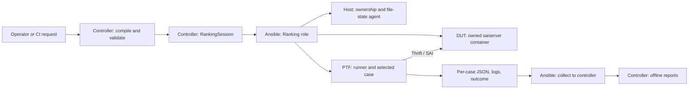

# Ranking Test implementation guide

Ranking evaluates switch ASIC functionality, scale, and SAI programming
performance through existing SAI PTF cases. A developer or CI job supplies the
test selection and an environment profile; the controller prepares that
environment, runs each selected case, archives its evidence, and restores the
state that Ranking changed.

The [community HLD](https://github.com/sonic-net/SONiC/blob/a0cb1e03316abb74387f35f941ed9f47cb2fdf60/doc/AINet-Test/Tier%201%20-%20Ranking%20Test%20HLD%20.md)
also covers IXIA/RestPy, line-rate traffic, and congestion testing. This migration
contains the PTF execution and reporting path. It does not implement an IXIA
backend or a common weighted score that ranks different chips.

The runtime contracts describe physical Fanout and vSONiC/OVS environments.
They are not a statement that a particular platform has passed device
validation. The operator supplies a prepared testbed, a local compatible
saiserver image, its launcher, and matching SAI headers and Python bindings.
Ranking does not build the image or provision the testbed.

## Responsibility and ownership

| Component | Owns | Boundary |
| --- | --- | --- |
| Controller input compiler | Case selection, mapping, configuration view, source and profile fingerprints | Reads local input; does not contact a device or import SAI cases |
| Controller lifecycle | One environment, ordered case runs, finalization, local artifacts | Calls the Ranking role; does not implement Docker or service operations |
| Controller receipt store | Receipt schema validation and atomic local persistence | Does not decide lifecycle transitions or contact hosts |
| Controller receipt policy | Setup attestation, keep/release transitions, completion decisions | Applies execution evidence without file or device operations |
| Host ownership and state agent | Resource reservation, exclusive action guards, authorized snapshots, file restoration, attempted-change ledger | Uses host-local storage; does not run Docker, systemd, or networking commands |
| Host transport | Deployment of the agent and its JSON requests through Ansible | Carries requests; does not decide whether an environment may be released |
| Ranking Ansible role | Service/container changes, staging, reset, collection, restoration checks | Acts on the authorized DUT and PTF environment |
| PTF runner and cases | Process lifetime, SAI switch/session creation, test assertions, measurements | Runs inside the PTF container; talks to saiserver over Thrift |
| Offline report | Archived-input validation, capability aggregation, metric rendering | Reads controller artifacts; does not require a live DUT or PTF container |

The DUT reservation covers the whole DUT, because the saiserver/ASIC session is
shared. A PTF reservation covers the identified host/container pair. Canonical
keys use the DUT machine identity and the PTF host machine identity plus the
full container ID, rather than inventory aliases. `environment_id` identifies
a retained environment; `operation_id` identifies the lifecycle operation that
holds it; `run_id` identifies one case attempt. A fresh `action_id` identifies
each role invocation, including explicit recovery. Reusing an environment and
operation does not authorize overlapping actions.

Reservation, state, and action roots are fixed on each managed host:
`/var/tmp/ranking-ownership`, `/var/tmp/ranking-state`, and
`/var/tmp/ranking-actions`. Different controllers therefore consult the same
records. Resource ownership retains the environment across actions; a separate
action guard prevents another invocation from resetting or restoring that
resource during an unfinished action. The controller's receipt is recovery
evidence, not a replacement for those host records.



### DUT operating system and data plane

`runtime.backend` chooses `physical_fanout` or `vsonic_ovs`.
`runtime.dut_os` independently describes the DUT operating system:

- `sonic` uses a configurable SONiC service-stop list and port baseline. Only
  services that were active are candidates for restoration.
- `none` is accepted for the physical backend. It describes a prepared Linux
  host with Docker and SDK/SAI/saiserver dependencies, without requiring SONiC
  services. The operator must supply image-identity and ASIC-owner information;
  SONiC-specific defaults must not be assumed for this profile.

The physical backend consumes an existing Fanout transport and explicit
PTF/interface/VLAN/Fanout/DUT/lane mapping. Ranking does not reconfigure that
Fanout. The virtual backend consumes existing veth/OVS connectivity and does
not invent physical VLAN or Fanout entries. The case owns `create_switch`;
an open RPC socket alone does not establish ASIC or data-plane readiness.

## Inputs and entry points

Run commands below from the repository root. Input and artifact output
directories must be new; source directories and the inventory are supplied by
the operator.

```bash
python3 -m tests.ranking.prepare_inputs \
  --request /path/to/request.json --output /path/to/new-inputs

PYTHONPATH="$PWD" python3 -m pytest \
  --confcutdir=tests/ranking tests/ranking/test_ranking.py \
  --ranking-inputs /path/to/new-inputs \
  --ranking-artifacts /path/to/new-artifacts
```

`prepare_inputs.compile_inputs()` takes `runtime`, `manifest`,
`source_identity`, one `selector`, DUT port/configuration data, and the PTF
port map. The physical backend additionally requires the connection graph.
It publishes three files together:

| File | Purpose |
| --- | --- |
| `inputs.json` | Runtime profile, detached manifest, selection, interface arguments, source identity and mapping hash |
| `port-mapping.json` | Ordered mapping used by the runner and environment checks |
| `ptf-config-db.json` | The selected-port configuration view consumed by cases |

`execution_config.load_execution_inputs()` rechecks the bundle and sidecars,
validates the source contract and adapter/binding identity, and calculates the
execution fingerprints. `runtime.execution` supplies inventory host aliases,
the RPC endpoint, PTF executable, prepared bindings/resources, and explicitly
declared launcher files. Source paths are controller paths; staging paths are
derived from `runtime.ptf_root` and the environment ID. Passwords or tokens do
not belong in the request; host-control authentication references prepared SSH
identity and known-host files.

## Actual call chain

1. [`conftest.py`](conftest.py) parameterizes one pytest item per selected
   `module.Class`. The session fixture constructs
   [`RankingSession`](lifecycle.py), registers `close()`, and calls `start()`.
2. `RankingSession.start()/run()/close()` call `Infra.call()` in
   [`ranking_infra.py`](ranking_infra.py). `invoke_role()` writes role variables,
   invokes `ansible-playbook` with an argument array, and preserves role stdout,
   stderr, outcome, and the environment receipt.
3. [`tasks/main.yml`](../../ansible/roles/ranking/tasks/main.yml) dispatches the
   role action. Each invocation deploys the host agent and validates ownership.
   Setup also discovers identities and obtains the reservations. The role
   acquires action guards on both resources before setup, run, or restoration
   work, and releases its acquired guards in `always`. Setup saves original
   state, applies declared changes, and stages PTF. Host requests enter
   `remote_agent._dispatch()` and use
   [`ResourceStore`](environment_ownership.py) and [`StateStore`](state_store.py).
4. [`tasks/run.yml`](../../ansible/roles/ranking/tasks/run.yml) authorizes the
   run, calls `prepare_case.yml`, invokes the runner, and collects artifacts in
   an authorized `always` block. Before reset, the previous process must have
   exited and its required artifacts must have been collected.
5. `execution_config.build_ptf_request()` supplies case, interfaces, paths,
   timeout, and scalar test parameters. [`ptf_runner.py`](ptf_runner.py) dispatches
   into the identified PTF container. `run_ptf()` runs the case in its own
   process session and writes logs and `outcome.json`.
6. The case imports `sai_base_test`, creates its SAI session, and records
   measurements/captured attribute associations. Collection copies this run's
   evidence and report inputs to the controller. `pytest_sessionfinish()` then
   invokes `report_runner.build_report()` on those archived files.

The host file-state agent is deliberately separate from device mutation:
writing an attempted-change marker is an agent operation; stopping a service
or launching a container is an Ansible operation. The role records intent
before the mutation so that partial failures remain recoverable.

## Capture, generated inputs, and reports

During setup, `prepare_ptf.yml` runs the existing generation pipeline on the
PTF host, then copies the staged runtime into the PTF container:

```bash
python3 pipeline/generate_artifacts.py \
  --inc headers --experimental headers-experimental \
  --adapter binding/sai_thrift/sai_adapter.py --out-dir ptf/ranking_test
```

- `attr_map.json` maps adapter function/argument names to SAI attribute,
  operation, union type, and positional signature for capture.
- `enum_values.json` resolves numeric enum values to header-defined names.
- `skeleton.json` defines the expected capability cells from standard SAI
  attributes and applicable operations. Create/set cells expand finite
  enum/bool domains; reads remain attribute-level. Experimental headers supply
  additional enum definitions.
- `spec_registry.json` is a supplied metric registry, not a generated result.
  It defines metric type, unit, operations, and comparison direction.

`TestResultCollector` writes `<module>_<Class>.json` with distinct
`attr_records`, measured `spec_results`, metadata, and collector diagnostics.
The runner's `outcome.json` separately describes the process exit and timeout.
The report derives the PTF case outcome from that outcome and the captured
test-runner log, rather than treating the collector's default result as proof
that pytest or PTF passed.

`report_runner.py` checks run identities, collection records, and consistent
batch inputs before producing `report/spec.html`, `report/capability.json`,
`report/capability.html`, and `report/report_status.json`. It can be rerun offline:

```bash
python3 -m tests.ranking.report_runner --artifact-root /path/to/artifacts
```

The capability report joins captured case associations to the full skeleton.
Its four states are `supported`, `partially_supported`, `not_supported`, and
`not_tested`. Here, `supported` means an associated case ultimately passed,
including a negative test that passed because a SAI call returned its expected
error. It does not mean every associated RPC returned success. Capture stores
case/attribute/operation/value associations without per-call SAI status. An
explicit case assertion failure supplies `not_supported` evidence; passing
and failing case evidence together produce `partially_supported`. Process
errors, skips, and timeouts supply no support verdict and are not automatically
classified as unsupported ASIC features.

The spec report shows capacity, programming rate,
latency, and fill-rate measurements. Numeric thresholds use the registry's
comparison direction; without a threshold the result is `MEASURED`, and an
absent registered measurement is `NOT MEASURED`. These are separate metric
results, not inputs to an implemented cross-chip weighted ranking.

The cases, collector, and core generation/reporting algorithms were migrated
from existing SAI Ranking assets. Independent controller lifecycle, host
ownership/receipt handling, runtime staging, capture installation, and archived
input validation are integration boundaries adapted for sonic-mgmt.

## Failure, retention, and recovery

- Invalid inputs fail before device execution. Ownership rejection does not
  authorize reset, collection, or cleanup of another environment.
- Setup failure preserves its primary error and recovery evidence. Only
  reservations proved unmodified can be aborted without restoration.
- A failed or timed-out case still attempts authorized collection. The runner
  checks process identity before signaling its own session. Unproven process
  exit or incomplete collection prevents a subsequent reset from destroying
  evidence.
- Teardown removes only the recorded owned container, restores declared files
  and original service state, and checks restoration before releasing resources.
  Unconfirmed restoration blocks release; uncertainty blocks automatic recovery.
  There is no timeout-based force takeover.
- `--ranking-keep-env` retains the environment while ending the operation.
  `--ranking-skip-setup` requires `--ranking-environment-id` and must reacquire
  and validate that retained environment.

Explicit recovery uses the controller receipt and the same host ownership and
action boundaries. A known idle active operation can be recovered; a matching
receipt cannot bypass an active or incomplete action guard. If a controller
dies before guard completion, Ranking refuses automatic takeover. An operator
must investigate the host and unfinished action before recovery; elapsed time
alone proves neither process exit nor restoration. There is no guard expiry or
automatic crash takeover.

Normal lifecycle finalization and CLI recovery apply the same receipt policy.
`receipt_store.py` validates and saves the local record; `receipt_policy.py`
returns an updated record, a completion decision, and a diagnostic. The
`ranking_infra.py` adapters persist that decision and report an incomplete
finalization even when the playbook returned zero.

Confirmed restoration, release, and ended-operation facts survive a later
failure. For example, the role can confirm release before its action guards
finish; a subsequent failure preserves the release facts and marks the result
uncertain. Unknown or contradictory evidence also prevents completion. A known,
restored partial release can be finished through guarded CLI recovery. Cleanup
preserves the original error and records later failures separately.

Recovery refuses mismatching or uncertain ownership:

```bash
python3 -m tests.ranking.ranking_infra --action teardown \
  --receipt /path/to/environment-receipt.json
```

## Local validation

The isolated unit suite does not require a DUT:

```bash
python3 -m pytest --confcutdir=tests/ranking/unit_tests -q tests/ranking/unit_tests/unit_test_*.py
```

Unit tests and static Ansible checks verify local contracts. They do not prove
physical port mapping, platform initialization, ASIC reset, or restoration
convergence on a real device.
