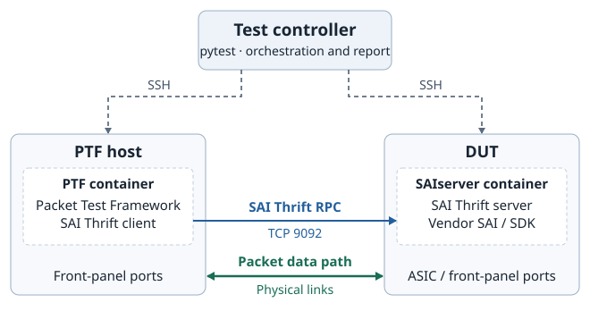

# Ranking Test

## What is Ranking Test?

Ranking Test is a framework for testing the Switch Abstraction Interface (SAI).
It includes functional and performance test cases and uses their results to
generate reports on the capabilities and performance of the ASIC under test.
Running the same SAI test scenarios across ASIC platforms makes the results
comparable.

## Minimum Test Topology

The minimum setup consists of a test controller, a PTF host, and a device under
test (DUT). The controller uses SSH to orchestrate both hosts and generates the
report from the collected results. The PTF container calls the DUT's SAIserver
over Thrift RPC. Test packets travel between the PTF and DUT front-panel ports.



The reference physical topology uses 32 data links.

## Directory Layout

Ranking lives under `tests/ranking/` in the sonic-mgmt repository.

```text
tests/ranking/
├── cases/
│   ├── ptf/                 PTF test cases and their helpers
│   └── manifest.json        Registered case names and priorities
├── environments/
│   └── sonic_sonic/         SONiC-to-SONiC environment template
├── prepare/                 Lab setup, checks, and case deployment
├── run/                     Case execution and result collection
├── report/                  Offline report generation and metadata
├── common/                  Shared utilities used by the framework
└── unit_tests/              Unit tests for Ranking itself
```

For example, `sairoute.multipleRoutesTest` refers to the `multipleRoutesTest`
class in `cases/ptf/sairoute.py`. Run selects cases from `cases/manifest.json`
and executes the deployed PTF code inside the PTF container.

## Test Workflow

Start with the stage your lab needs. Prepare and Run use the DUT/PTF pair.
Report uses the collected files and runs offline.

| Stage | What it does | Prerequisites |
| --- | --- | --- |
| Prepare | Configure and check the DUT/PTF environment, then publish the PTF cases. | Optional. Skip it if the lab and deployed cases are ready. |
| Run | Execute selected PTF cases and collect results and logs into a batch directory. | Requires a ready lab and an environment YAML. A manually prepared lab works too. |
| Report | Generate an HTML report from an existing batch. | Requires Run output, the case manifest, and report metadata from the checkout. |

### Environment and Prerequisites

The Prepare and Run examples use the SONiC-to-SONiC template at
`tests/ranking/environments/sonic_sonic/`. Before running the commands on
hardware, configure the addresses, wiring, and port files for your lab.
See the [template README](environments/sonic_sonic/README.md).

| Environment file | Purpose |
| --- | --- |
| `environment.yml` | DUT/PTF login, PTF runtime paths, and cable map. |
| `environment.py` | Validates the YAML and supplies the runtime configuration. |
| `prepare.py` | Implements the lab-specific setup and readiness checks. |
| `dut/config_db.json`, `dut/port_config.ini` | DUT port settings used by the PTF cases. |
| `ptf/port_config.ini`, `ptf/mirror_port.py` | PTF port list and ingress mirroring for this template. |

Reserve the DUT/PTF pair before Prepare or Run. The Linux controller needs
Docker, SSH access to both hosts, and a writable checkout. The managed hosts
need Python versions supported by the controller image's Ansible.

Start the controller container from the sonic-mgmt repository root on the
**controller host**. The image provides Python, PyYAML, pytest,
pytest-ansible, Ansible, and Paramiko.

```bash
ranking_image=sonicdev-microsoft.azurecr.io:443/docker-sonic-mgmt:latest
docker image inspect "$ranking_image" >/dev/null 2>&1 || docker pull "$ranking_image"

docker run --rm -it \
  --network host \
  --user "$(id -u):$(id -g)" \
  --mount "type=bind,source=$PWD,target=/work/sonic-mgmt" \
  --workdir /work/sonic-mgmt \
  --env HOME=/tmp \
  --env ANSIBLE_CONFIG=/work/sonic-mgmt/ansible/ansible.cfg \
  "$ranking_image" bash
```

Configure controller-to-device SSH using the
[template SSH instructions](environments/sonic_sonic/README.md#ssh-authentication).
The host UID/GID keeps the report and logs readable from the controller host.

<details>
<summary>Verified image on Linux 3.10 and Docker 18.06</summary>

The physical workflow passed with this image. On this legacy controller, set
`ranking_image` to the reference below and add
`--security-opt seccomp=unconfined` to `docker run`. Use
`controller.connection: paramiko` on this combination, where OpenSSH exits
with an entropy error.

```bash
ranking_image=sonicdev-microsoft.azurecr.io:443/docker-sonic-mgmt@sha256:cfa1e2c553a3b84f420414e0fa14096f0946adf54540ae61901f0a6140c24273
```

The security option disables the container seccomp profile. Use it only for
this isolated legacy test. Before downloading a new image, check free space
on the filesystem containing Docker's data root.

</details>

### Prepare (optional)

Prepare brings the DUT and PTF host to the state required for PTF tests.

1. `configure_env` calls the selected environment's setup logic.
2. `check_env` checks both hosts according to that environment's rules.
3. `sync_cases` publishes the PTF case tree and applies environment-specific files.

With the environment package configured and both hosts reachable, run from
`/work/sonic-mgmt` inside the controller container.

```bash
python3 -m pytest -s -v tests/ranking/prepare/test_prepare.py \
  --ranking-environment tests/ranking/environments/sonic_sonic \
  --ranking-cases tests/ranking/cases
```

| Option | Meaning |
| --- | --- |
| `--ranking-environment DIR` | Required. Directory containing `environment.yml`, `environment.py`, and `prepare.py`. |
| `--ranking-cases DIR` | Required for `sync_cases`. Pass the directory containing `ptf/`. |
| `--ranking-prepare-steps LIST` | Optional. Defaults to all three steps. Select a comma-separated subset, such as `check_env`. Selected steps run in `configure_env,check_env,sync_cases` order. |
| `--ranking-force-sync` | Optional. Replace an existing PTF case tree. Otherwise sync skips an existing tree and logs a warning. Use with `sync_cases`. |
| `-s -v` | pytest flags for live output and verbose test names. |

### Run

**Prerequisites.** The DUT and PTF must be ready. The PTF container needs
Python 3, the PTF launcher, the deployed cases and their dependencies, and a
`sai_thrift` binding compatible with the DUT. Match the PTF interfaces to the
configured wiring. Configure a route from PTF to the DUT's SAI RPC address
where needed and verify that the PTF container can reach it on TCP 9092.

If you prepared the lab manually, deploy the contents of `cases/ptf/` to
`ptf.case_dir` in the container. Put the DUT's `config_db.json` and
`port_config.ini` in that case directory's `resources/` folder.

Run from `/work/sonic-mgmt` inside the controller container.

```bash
python3 -m pytest -s -v tests/ranking/run/test_ranking.py \
  --ranking-config tests/ranking/environments/sonic_sonic/environment.yml \
  --ranking-output tests/ranking/output/route-batch-001 \
  --ranking-select case:sairoute.multipleRoutesTest
```

| Option | Meaning |
| --- | --- |
| `--ranking-config YAML` | Required. Use `environment.yml` with `environment.py` beside it. |
| `--ranking-output DIR` | Required. Writable batch directory on the controller. Pass the same directory to Report. |
| `--ranking-select SELECTOR` | Optional. Defaults to `priority:P0`. Accepts a case, module, priority, or a comma-separated selection. |
| `--ranking-live-log MODE` | Optional. `compact` (default), `full`, or `off`. Controls the console only. |
| `--collect-only` | Optional. Append to preview the selected pytest cases without running them. |
| `-s -v` | pytest flags for live output and verbose test names. |

For multiple cases, use one selector such as
`case:sairoute.multipleRoutesTest,case:sairoute.dropRouteTest`. For performance
measurements, run a case supported by your lab, such as
`ext_sai_counter_stress_test.CollectPortCountersTest`, with the same output
directory.

### Report

**Prerequisites**

- Python 3 and PyYAML on the controller, with the same checkout used for Run.
- The Run output batch, including the case result JSON files and logs under
  `cases/`.
- The checked-in case list `tests/ranking/cases/manifest.json` and the three
  files in `tests/ranking/report/metadata/`. These are `enum_values.json`,
  `skeleton.json`, and `spec_registry.json`.

After the desired cases finish, run offline from the sonic-mgmt repository root
on the controller (`/work/sonic-mgmt` inside the controller container).

```bash
python3 -m tests.ranking.report.generate \
  --ranking-output tests/ranking/output/route-batch-001
```

| Option | Meaning |
| --- | --- |
| `--ranking-output DIR` | Required. Use the same batch directory passed to Run. |
| `--ranking-config YAML` | Optional. Pass the same environment YAML used by Run to show the DUT ASIC, ASIC vendor, DUT IP, and PTF IP. |

Open `tests/ranking/output/route-batch-001/report/report.html`. The page
includes Test Results, Capability, and Performance & Scale. Keep `report/` and
`cases/` together in the batch so log links work. Case results and logs are
under `cases/<module>/results/<Class>.json` and `cases/<module>/logs/<Class>.log`
within the batch.

<details>
<summary>View over HTTP</summary>

Run from the same repository root on the controller.

```bash
python3 -m http.server 8000 --bind 127.0.0.1 \
  --directory tests/ranking/output/route-batch-001
```

From the controller host, open <http://127.0.0.1:8000/report/report.html>. For a
remote controller, use an SSH tunnel or copy the complete batch.

</details>

#### Optional maintenance for report metadata

Report uses the metadata already in the checkout. When the SAI headers or
reportable performance definitions change, run this command from the repository
root to regenerate all three metadata files together.

```bash
python3 -m tests.ranking.report.tools.generate_metadata \
  --headers /path/to/SAI/inc
```

Point `--headers` to the standard SAI header directory. Use
`--experimental-headers DIR` for each experimental header directory, if
applicable. The generator also reads the performance definitions in
`tests/ranking/cases/ptf/spec_registry.json` and writes all three files to
`tests/ranking/report/metadata/`.

### Verify and Wrap Up the Run

- **First run.** The example should show `1 passed` in pytest. In the report's
  Test Results tab, check that `sairoute.multipleRoutesTest` shows its status
  and duration, and open its log. Cases outside the selection show
  `NOT TESTED` in a fresh batch.
- **Reuse a batch.** Use the same `--ranking-output` to collect results for
  additional cases. A rerun replaces that case's result and log. Use a new
  batch directory when the ASIC or wiring changes.
- **Restore the lab.** After collecting the results, the operator or scheduler
  restores the DUT and PTF according to lab policy.
